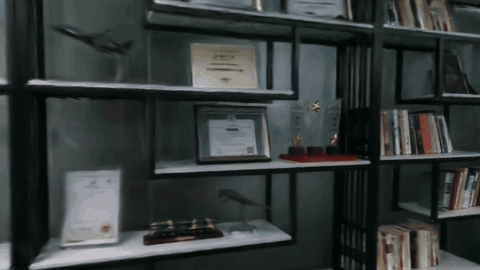
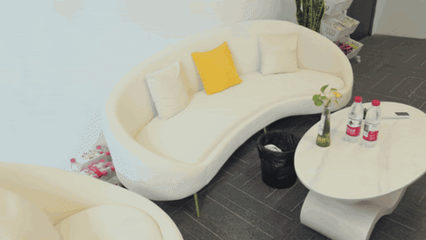
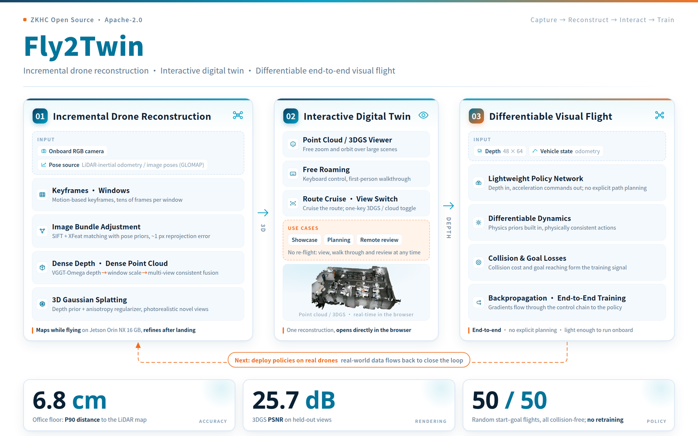

<div align="center">

# Fly2Twin

**Fly once, get a digital twin you can explore and fly in.**

Incremental drone reconstruction · Interactive digital twin · Differentiable visual flight

[](LICENSE) [](pyproject.toml) [](ROS_Compatibility_layer/README.md) [](ROS_Compatibility_layer/src/drone3d_reconstruction_core/docs/NX_BRINGUP.md)

**English** | [简体中文](README_zh.md)

</div>

<p align="center">
  
  
  
  
</p>
<p align="center"><sub>Top: incremental reconstruction along the capture trajectory; free roaming in the reconstructed office (3DGS). Bottom: a depth-based avoidance policy flying inside the reconstruction (inset: policy input); a lounge reconstructed from a phone video with the same pipeline.</sub></p>

**Fly2Twin** is an open-source framework that turns a single drone flight into a metric, photorealistic digital twin of an indoor space, and puts that twin directly to work for robots. It needs only an RGB camera and a pose source: LiDAR-inertial odometry on the drone, or poses recovered from the images themselves. The onboard computer builds the point cloud window by window during flight. After landing, the poses are refined with bundle adjustment and a 3D Gaussian Splatting (3DGS) model is trained. The resulting scene opens in any web browser for free roaming and drone piloting, and serves as a training ground for differentiable-physics flight policies.

## News

- **2026-11** — Initial public release (v0.1.0): onboard incremental reconstruction (ROS1), offline refinement and 3DGS, browser viewer, LiDAR-referenced evaluation, policy evaluation in reconstructed scenes.

## Contents

- [Overview](#overview)
- [Method](#method)
- [Results](#results)
- [Getting Started](#getting-started)
- [Repository Structure](#repository-structure)
- [Roadmap](#roadmap)
- [License](#license)
- [Citation](#citation)
- [Acknowledgements](#acknowledgements)
- [Community](#community)

## Overview

<p align="center"></p>

| Module | Location | What it does |
| --- | --- | --- |
| **Incremental drone reconstruction — onboard** | [`ROS_Compatibility_layer/`](ROS_Compatibility_layer/README.md) | ROS1 Noetic. Camera capture with motion-based keyframes, 40-frame VGGT-Omega windows, per-frame placement with the pose source, an incrementally updated multi-view point cloud, a delivery package, and post-flight global bundle adjustment. |
| **Incremental drone reconstruction — offline** | [`recon/`](recon/README.md), [`recon_core/`](recon_core/README.md) | Pluggable pose providers, image bundle adjustment, VGGT-Omega depth, window scale estimation, multi-view consistent fusion, 3DGS training and evaluation, scene export, LiDAR-referenced accuracy evaluation, and a camera-path / video toolkit for exported scenes. |
| **Interactive digital twin** | [`viewer/`](viewer/README.md) | Browser viewer for exported scenes: first-person roaming, drone piloting, 3DGS / point-cloud toggle, route cruise along the capture path, and multi-scene demos. No installation on the viewing side. |
| **Differentiable visual flight** | [`recon/sim/`](recon/docs/SIM.md); training in [DiffDrone-PyTorch3D](https://github.com/kirkchinese/Diffable_Drone_Pytorch3D) | A lightweight policy maps a 48×64 depth image directly to acceleration commands and is trained end to end through differentiable dynamics. `recon sim` turns an exported scene into a flight volume, samples start/goal pairs and flies the policy in closed loop. |

The window-scale solver and multi-view fusion are a single implementation shared by the onboard and offline sides (`recon_core`, NumPy/SciPy only, runs on Python 3.8 and 3.10).

## Method

1. **Keyframes and windows.** Drone data is thinned by motion: a frame becomes a keyframe when it has moved ≥ 0.15 m or rotated ≥ 8° from the previous keyframe, or after 2 s. This needs per-frame poses; offline, only the S380 preset enables it. A phone video is not thinned by motion: its timeline is split into 1200 equal bins (preset 400 × 3) and the sharpest frame of each bin is kept. Extraction always downscales to a 1920 px long edge (a 4K video gives 1920×1080); no later step uses the original resolution. Onboard, every window holds 40 keyframes, 5 of them shared with the previous window. Offline, the first window holds 40 keyframes and each following window adds 30 new keyframes plus 10 shared ones.
2. **Dense depth.** Each window is processed by [VGGT-Omega](https://github.com/facebookresearch/vggt-omega), which predicts per-frame depth (up to one scale per window) and confidence.
3. **Pose source.** Replaceable. On the drone, poses come from LiDAR-inertial odometry (FAST-LIO), interpolated to the RGB timestamps with a calibrated time offset. Without external localization (phone video), the cameras and depth that VGGT-Omega predicts for each window are used directly (`pose.provider: vggt`): consecutive windows are joined on the frames they share, with the scale taken from the ratio of the two depth maps of the same frame; matched features are lifted to 3D with the depth and used for a loop-closure correction; a feature bundle adjustment with self-calibration of the camera follows. No structure-from-motion solve is involved, and every frame keeps a pose. Images alone give no metric scale; the phone preset assumes a walking speed of 1 m/s. This is an assumption, not a measurement. Offline, an optional step (`pose.refine: ba`; on in the S380 preset, off in the phone preset) feeds SIFT and XFeat matches into a bundle adjustment that uses the source poses as position priors (σ = 5 cm), with the reprojection threshold tightened over three rounds (16 → 8 → 4 px). For scenes with very few observations a rotation prior can be switched on (`pose.rotation_sigma_deg`, off by default): rotations then stay fixed in the joint adjustment and are solved per image after each round against the source rotation.
4. **Window scale.** Each window receives one metric scale that satisfies two constraints at once: the scale ratio between the VGGT camera trajectory and the pose-source trajectory, and the depth ratio on frames shared with neighboring windows. The scales are solved jointly by weighted least squares in log space and re-solved globally whenever a window arrives, so later observations correct earlier estimates. Onboard, each frame additionally gets a deviation from its window scale, and frames inside a window constrain each other through frame-pair depth ratios as well; offline uses one scale per window.
5. **Revisit alignment.** The scale solve only links views that are close in pose. When a surface is seen again later from somewhere else, the scales of the two windows drift independently and the fused cloud shows the same wall twice. Before fusion, the points of each window are matched point-to-plane against the points of the other windows, and one scale correction per frame is solved by sparse least squares (corrections are pulled towards zero and kept smooth inside a window). Only depth scales change, never poses; a frame that shares no surface with another window keeps its scale. Onboard, this step runs when the delivery package is exported, not on the live point cloud during flight; offline it is enabled by `fusion.revisit`, which the S380 preset turns on and the phone preset does not.
6. **Multi-view consistent fusion.** Every pixel is checked against up to 6 neighboring views within 1.5 m and 30°; a neighbor supports it when the log depth ratio is below 0.03, at least min(2, visible views) supporting neighbors are required, and only depths of 0.3–4 m are kept. Points are merged on a 2 cm voxel grid, which coarsens adaptively when a point budget is exceeded. For a phone video these thresholds apply in the assumed metres of step 3 (walking speed).
7. **3DGS.** Gaussians are initialized from a second, more complete cloud of the fusion stage (lower confidence threshold, no depth range; for phone and drone data alike) and trained with L1/SSIM photometric losses, a log-depth difference against the VGGT depth as scaled by the fusion stage (weight 0.1, computed per frame), and an anisotropy penalty that suppresses needle-shaped Gaussians.

## Results

A full office floor was captured with the S380 drone's sensor suite (Intel RealSense D435i RGB at 1280×720, Livox MID-360, Jetson Orin NX 16 GB) in 27 minutes, yielding 3,470 keyframes.

| Scene | Pose source | Metric | Value |
| --- | --- | --- | --- |
| Office floor, onboard point cloud | FAST-LIO | Distance to LiDAR map, P50 / P90 | 2.9 / 6.0 cm |
| Office floor, after post-flight BA | FAST-LIO + BA | Distance to LiDAR map, P50 / P90 | **2.7 / 4.7 cm** |
| Office floor, 3DGS | FAST-LIO + BA | PSNR, 433 held-out views (640×360, test-time pose alignment) | **25.7 dB** |
| Lounge, phone video (shot in 4K, trained at 1600×900) | Chained VGGT windows + feature BA, assumed 1 m/s walking speed | PSNR, 150 held-out views (fixed poses, 1600×900) | **34.1 dB** |
| Onboard, Jetson Orin NX 16 GB | FAST-LIO | Per 40-frame window: GPU inference / total | 38 s / 42 s |
| Obstacle avoidance in the reconstructed office (`recon sim`) | — | 50 random start–goal pairs, policy trained in random obstacle fields | **50 / 50** collision-free |

Distances are measured from each reconstructed point to a LiDAR map built from the same recording ([protocol](recon/docs/LIDAR_EVAL.md)). Both distance rows come from one flight: the onboard row is the cloud exported after replaying the whole recording through the onboard pipeline with the current configuration (40 frames, 5 shared), and the BA row is the cloud fused under the BA poses; three runs with different matching seeds gave 2.73–2.74 / 4.60–4.68 cm ([pitfalls](recon/docs/PITFALLS.md), item 8). Both include revisit alignment (step 5 of the method). The figures published earlier, 3.3 / 11.2 cm and 2.9 / 6.8 cm, predate per-frame scales (onboard) and revisit alignment. The 3DGS and obstacle-avoidance rows were also measured before revisit alignment was added and have not been re-measured.

Phone row: the video is 3840×2160. 1200 frames are taken and downscaled to 1920×1080 at extraction; poses and depth use these images, and 3DGS is trained and evaluated at 1600×900. It was never trained at 4K. The scale comes from the assumed walking speed of 1 m/s. On 2026-11-27 the current code was run from the video file end to end (all 1200 frames have a pose) and gave 34.13 dB. The previously published 32.6 dB used GLOMAP poses; on videos shot while walking GLOMAP can break the trajectory into pieces of different scale, and it is no longer used as of 2026-11-27.

## Getting Started

### Requirements

| Component | Tested configuration |
| --- | --- |
| Offline pipeline | Ubuntu 22.04, Python ≥ 3.10, NVIDIA GPU with ≥ 8 GB, PyTorch 2.7 + CUDA 12.8 toolkit; video input needs `ffmpeg` and `ffprobe` (4.4 or newer; the one Ubuntu 22.04 ships works); the phone preset holds about 10–12 GB of host memory while training |
| Onboard | Ubuntu 20.04, ROS1 Noetic, Jetson Orin NX 16 GB, a pose source publishing `nav_msgs/Odometry` (e.g. FAST-LIO) |
| Viewer | Any browser with WebGL2 |

### Model weights

- **VGGT-Omega** — request access on [Hugging Face](https://huggingface.co/facebook/VGGT-Omega) and download `vggt_omega_1b_512.pt`; set its path in `depth.weights` (offline) or in the reconstruction profile (onboard).
- **XFeat** — used by bundle adjustment; see [`recon/docs/INSTALL.md`](recon/docs/INSTALL.md).

### Installation

```bash
git clone https://github.com/ZKHC-Lab/fly2twin.git
cd fly2twin
# Install a CUDA-matched PyTorch first, then:
python -m pip install -e '.[core,train]'
```

Toolchain details (CUDA headers for gsplat, GPU architecture) are in [`recon/docs/INSTALL.md`](recon/docs/INSTALL.md).

### Quick start: from a phone video to an explorable scene

```bash
cp configs/phone_video.yaml my_scene.yaml   # set `video`, `depth.weights` and `output`
recon run --config my_scene.yaml            # prepare → pose → depth → fuse → train → eval → export
python3 -m viewer.tools.demo <export_dir>   # serve the exported scene and open it in a browser
```

All seven stages run in order; the depth stage needs the VGGT-Omega weights. Frame selection (`extract`), training width (`train.max_width`) and the walking-speed assumption (`pose.metric.speed_mps`) of the phone preset are described in steps 1 and 3 of the method.

For drone data with external poses, start from [`configs/drone_with_poses.yaml`](configs/drone_with_poses.yaml). The input contract and every configuration key are documented in [`recon/docs/INPUTS.md`](recon/docs/INPUTS.md).

### Onboard reconstruction (ROS1 Noetic)

```bash
source /opt/ros/noetic/setup.bash
cd ROS_Compatibility_layer
catkin_make && source devel/setup.bash
bash src/drone3d_reconstruction_core/scripts/continuous_production.sh \
  --front-profile <front_capture_profile.yaml> --down-profile <down_capture_profile.yaml> \
  --reconstruct-profile <reconstruct_profile.yaml> --continuous-profile <continuous_profile.yaml> --web
```

The web console runs at `http://127.0.0.1:8080`. Hardware bring-up on the Jetson Orin NX, the delivery package and post-flight BA are described in [`NX_BRINGUP.md`](ROS_Compatibility_layer/src/drone3d_reconstruction_core/docs/NX_BRINGUP.md) and [`ONBOARD_V1.md`](ROS_Compatibility_layer/src/drone3d_reconstruction_core/docs/ONBOARD_V1.md).

### Policy evaluation in a reconstructed scene

```bash
python -m pip install -e '.[core,sim]'
git clone https://github.com/kirkchinese/Diffable_Drone_Pytorch3D.git   # policy and dynamics
recon sim prepare <export_dir> scene.npz --ceiling-z 2.95             # level floor, close ceiling
recon sim pairs scene.npz pairs.npz                                    # 50 start/goal pairs at 1.2 m
recon sim eval scene.npz pairs.npz eval/ --diffdrone Diffable_Drone_Pytorch3D \
  --checkpoint exp21_grad_clip_goal_best_ar.pth                       # from its v0.1.0 release
```

On the office scene these commands run in about a minute on CPU. Definitions and the checkpoint checksum are in [`recon/docs/SIM.md`](recon/docs/SIM.md).

### Viewer controls

| Key | Action |
| --- | --- |
| `W` `A` `S` `D` / `R` `F` | Move / ascend and descend |
| Mouse drag | Look around |
| `Tab` | Switch to drone flight mode |
| `V` | Toggle 3DGS / point cloud |
| `P` | Cruise along the capture route |
| `G` | Toggle capture-corridor guidance |

### Evaluation and tests

```bash
python -m pip install -e '.[lidar,test]'
recon lidar-reference ...   # build a LiDAR reference map from a ROS1 bag
recon lidar-distance ...    # distances from a reconstruction to the reference
python -m pytest tests      # CPU test suite
```

ROS-side tests: `catkin_make run_tests -j1 && catkin_test_results --verbose` inside `ROS_Compatibility_layer`.

## Repository Structure

```text
fly2twin/
├── ROS_Compatibility_layer/   # Onboard ROS1 workspace: capture, windowed inference, online map, delivery, BA
├── recon/                     # Offline pipeline: poses, BA, depth, fusion, 3DGS, export, evaluation, reel, sim
├── recon_core/                # Numerical core shared by onboard and offline (window scale, fusion)
├── viewer/                    # Browser viewer and demo tools
├── configs/                   # Example configurations (phone video, drone with poses, image only, S380)
├── third_party/vggt-omega/    # VGGT-Omega model code and inference entry
├── scripts/ · tests/          # Link check and test suite
└── licenses/ · requirements-lock/ · THIRD_PARTY_NOTICES.md
```

## Roadmap

- [x] Onboard incremental reconstruction on Jetson Orin NX
- [x] Post-flight bundle adjustment and 3DGS training
- [x] Browser viewer with drone piloting
- [x] Policy evaluation inside reconstructed scenes (`recon sim`, 50 / 50)
- [ ] Onboard processing at capture rate
- [ ] Training policies directly in reconstructed scenes
- [ ] Multi-drone collaborative reconstruction
- [ ] Legged robots

## License

Fly2Twin is released under the [Apache License 2.0](LICENSE). `third_party/vggt-omega/` and its outputs are under the [FAIR Noncommercial Research License](third_party/vggt-omega/LICENSE). DiffDrone-PyTorch3D (GPL-3.0) is a separate repository that `recon sim` imports at run time. Other third-party components are listed in [`THIRD_PARTY_NOTICES.md`](THIRD_PARTY_NOTICES.md).

## Citation

If you find Fly2Twin useful in your research, please cite:

```bibtex
@misc{fly2twin2026,
  title  = {Fly2Twin: Fly Once, Get a Trainable Digital Twin},
  author = {Xu, Lu and Xu, Bin and {ZKHC}},
  year   = {2026},
  url    = {https://github.com/ZKHC-Lab/fly2twin}
}
```

When using the differentiable flight module, please also cite:

```bibtex
@misc{diffdrone_pytorch3d,
  title  = {DiffDrone-PyTorch3D: A PyTorch3D-based Differentiable Drone Simulator},
  author = {Xu, Lu},
  year   = {2026},
  url    = {https://github.com/kirkchinese/Diffable_Drone_Pytorch3D}
}

@article{zhang2025diffphysdrone,
  title   = {Learning vision-based agile flight via differentiable physics},
  author  = {Zhang, Yuang and Hu, Yu and Song, Yunlong and Zou, Danping and Lin, Weiyao},
  journal = {Nature Machine Intelligence},
  year    = {2025}
}
```

## Acknowledgements

Fly2Twin is developed and maintained by ZKHC (中科华创). Author: Lu Xu. Project team: Bin Xu, Lu Xu. It builds on excellent open-source work:

- [VGGT-Omega](https://github.com/facebookresearch/vggt-omega) (Visual Geometry Group, University of Oxford; Meta AI) for dense depth;
- [DiffPhysDrone](https://github.com/HenryHuYu/DiffPhysDrone) (Zhang et al., *Nature Machine Intelligence*, 2025), of which [DiffDrone-PyTorch3D](https://github.com/kirkchinese/Diffable_Drone_Pytorch3D) is a PyTorch3D reimplementation and extension;
- [FAST-LIO](https://github.com/hku-mars/FAST_LIO) for LiDAR-inertial odometry;
- [COLMAP](https://github.com/colmap/colmap) / pycolmap for feature matching, triangulation and bundle adjustment;
- [XFeat](https://github.com/verlab/accelerated_features) for feature matching;
- [gsplat](https://github.com/nerfstudio-project/gsplat) for Gaussian Splatting;
- [three.js](https://github.com/mrdoob/three.js) and [Spark](https://github.com/sparkjsdev/spark) for the browser viewer.

Questions and bug reports are welcome on [GitHub Issues](https://github.com/ZKHC-Lab/fly2twin/issues).

## Community

<p align="center"></p>

The group is Chinese-speaking. The WeChat invite QR code is valid for 7 days; if it has expired, ask for a new one in [GitHub Issues](https://github.com/ZKHC-Lab/fly2twin/issues).
