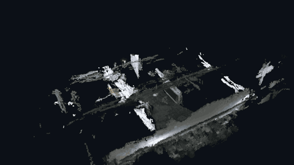
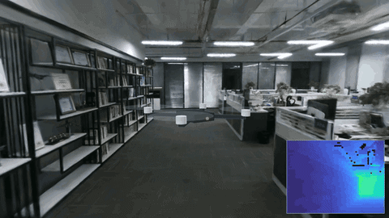
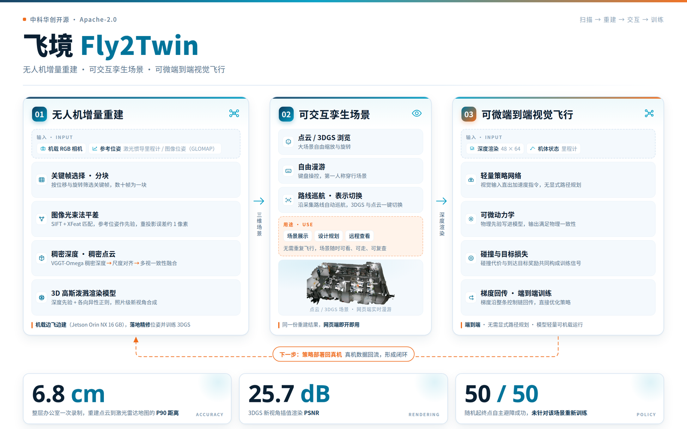

<div align="center">

# 飞境 Fly2Twin

**飞一趟，把真实空间变成可漫游、可飞行的数字孪生。**

无人机增量重建 · 可交互孪生场景 · 可微视觉飞行

[](LICENSE) [](pyproject.toml) [](ROS_Compatibility_layer/README.md) [](ROS_Compatibility_layer/src/drone3d_reconstruction_core/docs/NX_BRINGUP.md)

[English](README.md) | **简体中文**

</div>

<p align="center">
  
  
  
  
</p>
<p align="center"><sub>上：沿采集轨迹增量重建；在重建的办公室中自由漫游（3DGS）。下：基于深度的避障策略在重建场景中飞行（小窗为策略输入）；同一流程用手机视频重建的休息室。</sub></p>

**飞境（Fly2Twin）** 是一个开源框架：无人机在室内飞一趟，就能得到这片空间的米制、照片级数字孪生，并直接交给机器人使用。它只需要一台 RGB 相机和一个位姿来源：无人机上用激光惯导里程计，没有外部定位时由图像求位姿。机载计算机在飞行中逐窗口重建点云；落地后用光束法平差（BA）精修位姿，并训练 3D 高斯泼溅（3DGS）模型。重建好的场景在任意浏览器中打开即可自由漫游、操控无人机飞行，也可以作为可微物理飞行策略的训练场。

## 新闻

- **2026-11** — 首次公开发布（v0.1.0）：机载增量重建（ROS1）、离线精修与 3DGS、浏览器查看器、激光雷达参照评测、重建场景中的策略评测。

## 目录

- [概览](#概览)
- [方法](#方法)
- [结果](#结果)
- [快速上手](#快速上手)
- [仓库结构](#仓库结构)
- [路线图](#路线图)
- [许可](#许可)
- [引用](#引用)
- [致谢](#致谢)

## 概览

<p align="center"></p>

| 模块 | 位置 | 内容 |
| --- | --- | --- |
| **无人机增量重建 · 机载** | [`ROS_Compatibility_layer/`](ROS_Compatibility_layer/README.md) | ROS1 Noetic：相机采集与运动关键帧、40 帧分窗 VGGT-Omega 推理、按位姿来源逐帧放置、增量更新的多视融合点云、交付包，以及落地后的全局 BA。 |
| **无人机增量重建 · 离线** | [`recon/`](recon/README.md)、[`recon_core/`](recon_core/README.md) | 可替换的位姿来源、图像 BA、VGGT-Omega 深度、窗口尺度估计、多视一致性融合、3DGS 训练与评测、场景导出、激光雷达参照精度评测，以及面向导出场景的运镜与成片工具。 |
| **可交互孪生场景** | [`viewer/`](viewer/README.md) | 浏览器查看器：第一人称漫游、操控无人机、3DGS / 点云切换、沿采集路线巡航、多场景演示。查看端无需安装。 |
| **可微视觉飞行** | [`recon/sim/`](recon/docs/SIM.md)；训练在 [DiffDrone-PyTorch3D](https://github.com/kirkchinese/Diffable_Drone_Pytorch3D) | 轻量策略网络读入 48×64 深度图，直接输出加速度指令，经可微动力学端到端训练。`recon sim` 把导出的场景整理成飞行空间、采样起终点，闭环飞行策略。 |

窗口尺度求解与多视融合在机载端和离线端是同一份实现（`recon_core`，只依赖 NumPy / SciPy，Python 3.8 与 3.10 均可运行）。

## 方法

1. **关键帧与分窗**：无人机数据在相对上一关键帧平移 ≥ 0.15 m、转角 ≥ 8° 或间隔达 2 s 时取一帧；手机视频按时间均匀分段，每段取最清晰的一帧。机载每窗 40 个关键帧，其中 5 个与上一窗共享；离线首窗 40 帧，之后每窗 30 个新帧加 10 个共享帧。
2. **稠密深度**：每个窗口送入 [VGGT-Omega](https://github.com/facebookresearch/vggt-omega)，得到每帧深度（每窗相差一个尺度）和置信度。
3. **位姿来源**：可替换。无人机上用激光惯导里程计（FAST-LIO），按标定的时间偏移插值到 RGB 时刻；没有外部定位时用 GLOMAP 由图像求位姿。离线用 SIFT 与 XFeat 匹配做 BA，以来源位姿为位置先验（σ = 5 cm），重投影阈值三轮收紧（16 → 8 → 4 px）。
4. **窗口尺度**：每个窗口一个米制尺度，同时满足两类约束：VGGT 相机轨迹与位姿来源轨迹的尺度比、相邻窗口共享帧上的深度比。在对数域做加权最小二乘联合求解，每来一窗全局重解一次，后来的观测会修正前面的估计。机载端在窗口尺度之外再给每帧解一个偏差，同一窗口内的帧也用帧对深度比互相约束；离线端每窗一个尺度。
5. **回访约束**：上一步只在位姿相近的视角之间建立深度约束。同一处表面隔一段时间从别处再次被看到时，两个窗口的尺度各自漂移，融合后同一面墙会出现两层。融合前把每个窗口的点与其他窗口的点做点到面匹配，再给每帧解一个尺度修正量（稀疏最小二乘；修正量被拉向零，并在窗口内保持平滑）。只改深度尺度，不改位姿；与别的窗口没有共同表面的帧保持原尺度。机载端在导出交付包时执行这一步，飞行中的实时点云不做。
6. **多视一致性融合**：每个像素与最多 6 个近邻视角比对，深度对数比 < 0.03 计为支持，至少需要 min(2, 可见视角数) 个支持；点在 2 cm 体素上合并，点数超出上限时自适应放大体素。
7. **3DGS**：用融合点云初始化高斯，损失包括 L1 / SSIM 图像项、与 VGGT 逆深度的 Pearson 相关项，以及抑制针状高斯的各向异性惩罚。

## 结果

用 S380 无人机的传感器组（Intel RealSense D435i RGB 1280×720、Livox MID-360、Jetson Orin NX 16 GB）采集一整层办公室，27 分钟，3470 个关键帧。

| 场景 | 位姿来源 | 指标 | 数值 |
| --- | --- | --- | --- |
| 办公室，机载点云 | FAST-LIO | 到激光雷达地图的距离 P50 / P90 | 3.3 / 11.2 cm |
| 办公室，落地 BA 后 | FAST-LIO + BA | 到激光雷达地图的距离 P50 / P90 | **2.9 / 6.8 cm** |
| 办公室，3DGS | FAST-LIO + BA | PSNR，433 个留出视角（640×360，测试时位姿对齐） | **25.7 dB** |
| 休息室，手机 4K 视频 | GLOMAP | PSNR，150 个留出视角（1600×900） | **32.6 dB** |
| 机载 Jetson Orin NX 16 GB | FAST-LIO | 每个 40 帧窗口：GPU 推理 / 总处理 | 38 s / 42 s |
| 重建办公室中的避障（`recon sim`） | — | 50 组随机起终点，策略在随机障碍场景中训练 | **50 / 50** 无碰撞 |

距离为每个重建点到同一次录制的激光雷达地图的距离（[评测方法](recon/docs/LIDAR_EVAL.md)）。

## 快速上手

### 环境

| 组件 | 测试配置 |
| --- | --- |
| 离线流程 | Ubuntu 22.04、Python ≥ 3.10、NVIDIA 显卡 ≥ 8 GB、PyTorch 2.7 + CUDA 12.8 工具链 |
| 机载 | Ubuntu 20.04、ROS1 Noetic、Jetson Orin NX 16 GB、发布 `nav_msgs/Odometry` 的位姿来源（如 FAST-LIO） |
| 查看器 | 支持 WebGL2 的浏览器 |

### 模型权重

- **VGGT-Omega**：在 [Hugging Face](https://huggingface.co/facebook/VGGT-Omega) 申请并下载 `vggt_omega_1b_512.pt`，路径填入 `depth.weights`（离线）或重建 profile（机载）。
- **XFeat**：BA 使用，见 [`recon/docs/INSTALL.md`](recon/docs/INSTALL.md)。

### 安装

```bash
git clone https://github.com/ZKHC-Lab/fly2twin.git
cd fly2twin
# 先安装与 CUDA 匹配的 PyTorch，再：
python -m pip install -e '.[core,train]'
```

工具链细节（gsplat 所需的 CUDA 头文件、GPU 架构）见 [`recon/docs/INSTALL.md`](recon/docs/INSTALL.md)。

### 从手机视频到可漫游场景

```bash
cp configs/phone_video.yaml my_scene.yaml   # 填写 video、depth.weights 与 output
recon run --config my_scene.yaml            # prepare → pose → depth → fuse → train → eval → export
python3 -m viewer.tools.demo <导出目录>      # 启动服务并在浏览器中打开导出的场景
```

带外部位姿的无人机数据从 [`configs/drone_with_poses.yaml`](configs/drone_with_poses.yaml) 开始；输入契约与全部配置项见 [`recon/docs/INPUTS.md`](recon/docs/INPUTS.md)。

### 机载重建（ROS1 Noetic）

```bash
source /opt/ros/noetic/setup.bash
cd ROS_Compatibility_layer
catkin_make && source devel/setup.bash
bash src/drone3d_reconstruction_core/scripts/continuous_production.sh \
  --front-profile <front_capture_profile.yaml> --down-profile <down_capture_profile.yaml> \
  --reconstruct-profile <reconstruct_profile.yaml> --continuous-profile <continuous_profile.yaml> --web
```

Web 控制台在 `http://127.0.0.1:8080`。Jetson Orin NX 上的硬件启动、交付包与落地 BA 见 [`NX_BRINGUP.md`](ROS_Compatibility_layer/src/drone3d_reconstruction_core/docs/NX_BRINGUP.md) 和 [`ONBOARD_V1.md`](ROS_Compatibility_layer/src/drone3d_reconstruction_core/docs/ONBOARD_V1.md)。

### 重建场景中的策略评测

```bash
python -m pip install -e '.[core,sim]'
git clone https://github.com/kirkchinese/Diffable_Drone_Pytorch3D.git   # 策略与动力学
recon sim prepare <导出目录> scene.npz --ceiling-z 2.95                # 找平地面、补天花板
recon sim pairs scene.npz pairs.npz                                    # 1.2 m 高度采 50 对起终点
recon sim eval scene.npz pairs.npz eval/ --diffdrone Diffable_Drone_Pytorch3D \
  --checkpoint exp21_grad_clip_goal_best_ar.pth                       # 取自其 v0.1.0 release
```

办公室场景在 CPU 上约 1 分钟跑完。各项定义与权重校验值见 [`recon/docs/SIM.md`](recon/docs/SIM.md)。

### 查看器按键

| 按键 | 操作 |
| --- | --- |
| `W` `A` `S` `D` / `R` `F` | 移动 / 上升与下降 |
| 鼠标拖动 | 转动视角 |
| `Tab` | 切换到无人机飞行模式 |
| `V` | 3DGS / 点云切换 |
| `P` | 沿采集路线巡航 |
| `G` | 开关采集走廊引导 |

### 评测与测试

```bash
python -m pip install -e '.[lidar,test]'
recon lidar-reference ...   # 由 ROS1 bag 构建激光雷达参照地图
recon lidar-distance ...    # 重建点云到参照地图的距离
python -m pytest tests      # CPU 测试
```

ROS 端测试：在 `ROS_Compatibility_layer` 中运行 `catkin_make run_tests -j1 && catkin_test_results --verbose`。

## 仓库结构

```text
fly2twin/
├── ROS_Compatibility_layer/   # 机载 ROS1 工作空间：采集、分窗推理、在线地图、交付包、BA
├── recon/                     # 离线流程：位姿、BA、深度、融合、3DGS、导出、评测、成片、仿真评测
├── recon_core/                # 机载与离线共用的数值核心（窗口尺度、融合）
├── viewer/                    # 浏览器查看器与演示工具
├── configs/                   # 配置示例（手机视频、带位姿无人机、纯图像、S380）
├── third_party/vggt-omega/    # VGGT-Omega 模型代码与推理入口
├── scripts/ · tests/          # 等价验收与测试
└── licenses/ · requirements-lock/ · THIRD_PARTY_NOTICES.md
```

## 路线图

- [x] Jetson Orin NX 上的机载增量重建
- [x] 落地 BA 与 3DGS 训练
- [x] 可操控无人机的浏览器查看器
- [x] 重建场景中的策略评测（`recon sim`，50 / 50）
- [ ] 机载处理跟上采集速度
- [ ] 直接在重建场景中训练策略
- [ ] 多机协同重建
- [ ] 足式机器人

## 许可

飞境采用 [Apache License 2.0](LICENSE) 发布。`third_party/vggt-omega/` 及其输出适用 [FAIR 非商业研究许可](third_party/vggt-omega/LICENSE)。DiffDrone-PyTorch3D（GPL-3.0）是独立仓库，`recon sim` 在运行时导入。其余第三方组件见 [`THIRD_PARTY_NOTICES.md`](THIRD_PARTY_NOTICES.md)。

## 引用

如果飞境对你的研究有帮助，请引用：

```bibtex
@misc{fly2twin2026,
  title  = {Fly2Twin: Fly Once, Get a Trainable Digital Twin},
  author = {Xu, Lu and Xu, Bin and {ZKHC}},
  year   = {2026},
  url    = {https://github.com/ZKHC-Lab/fly2twin}
}
```

使用可微视觉飞行模块时请同时引用：

```bibtex
@misc{diffdrone_pytorch3d,
  title  = {DiffDrone-PyTorch3D: A PyTorch3D-based Differentiable Drone Simulator},
  author = {Xu, Lu},
  year   = {2026},
  url    = {https://github.com/kirkchinese/Diffable_Drone_Pytorch3D}
}

@article{zhang2025diffphysdrone,
  title   = {Learning vision-based agile flight via differentiable physics},
  author  = {Zhang, Yuang and Hu, Yu and Song, Yunlong and Zou, Danping and Lin, Weiyao},
  journal = {Nature Machine Intelligence},
  year    = {2025}
}
```

## 致谢

飞境由中科华创（ZKHC）开发并维护。作者：徐路；项目团队：许彬、徐路。它建立在以下优秀的开源工作之上：

- [VGGT-Omega](https://github.com/facebookresearch/vggt-omega)（牛津大学 VGG 组；Meta AI）：稠密深度；
- [DiffPhysDrone](https://github.com/HenryHuYu/DiffPhysDrone)（Zhang et al., *Nature Machine Intelligence*, 2025）：[DiffDrone-PyTorch3D](https://github.com/kirkchinese/Diffable_Drone_Pytorch3D) 是它的 PyTorch3D 复现与扩展；
- [FAST-LIO](https://github.com/hku-mars/FAST_LIO)：激光惯导里程计；
- [COLMAP](https://github.com/colmap/colmap) / [GLOMAP](https://github.com/colmap/glomap) / pycolmap：运动恢复结构与 BA；
- [XFeat](https://github.com/verlab/accelerated_features)：特征匹配；
- [gsplat](https://github.com/nerfstudio-project/gsplat)：高斯泼溅；
- [three.js](https://github.com/mrdoob/three.js) 与 [Spark](https://github.com/sparkjsdev/spark)：浏览器查看器。

问题与缺陷欢迎在 [GitHub Issues](https://github.com/ZKHC-Lab/fly2twin/issues) 提出。
