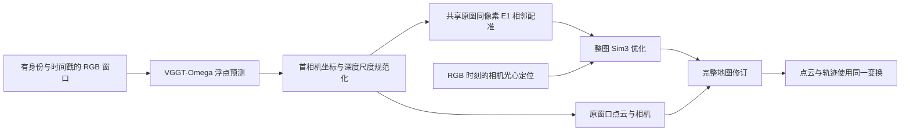

# G4 算法基线与 ROS 移植规范

状态：基线找回与源码核验版，2026-10-07。对象：用户认可的 G4 总体布局；本轮没有修改 ROS 生产实现、启动推理或替换基准。代码审计起点 `27bacf9`。本文件属于**技术规范（Spec）**，同时给出算法依据、接口约束、差异和验收方法。未决方案可另立 RFC，实施后的关键选择可记为 ADR；本项目不用含义不明确的 OPC 作为文档名。

> **自含性说明**:本文及 §9 已内联全部关键结论、参数、哈希与验收容差。引用的 `Data/experiments/…` 原始证据只存在于本机(不进 Git),文中出现时仅作来源标注;§9.5 给出路径索引。克隆仓库的读者无需这些文件即可理解规范,但无法复核原始数组与日志。

## 1. 结论与适用边界

**G4 已找回，图优化核心已在正式 ROS 仓库内；当前 ROS 全链路还不能宣称与认可实验效果一致。** 原基准是 `vggt_omega_backend_G4_20260916`，即 `run_02/results/graphs.json` 的 `backend_G4`。所谓“G4 综合最优”不是一份后来合并了全部研究修订的新地图。R1 的鲁棒权重修订、S14 手工边权、短窗、回环、联合 BA 均不能自动归入它。

本轮执行结果：14 项保护文件 SHA-256 和字节数全部一致；当前正式核心对冻结 **38 节点、35 条边、602 个位置因子**重新求解，尺度、旋转、平移、目标函数及保留的 **3774 个去重光心**与冻结结果差值均为 0。用时 44.323 s，CPU 进程峰值 RSS 106.75 MiB，Python 3.10.20 / NumPy 1.26.4 / SciPy 1.15.3，BLAS 单线程。它只证明这组冻结输入的图求解一致，不能代替 RGB→预测→配准→点云的全链路验证。本轮数值结果

人工认可范围是 **F000–F036 的总体布局**，F037 待定；正式几何验收没有通过。原结果保留 F023→F024 的 report 池重投影 P95=559.804 px；主航段 493 个定位留出光心 RMS=0.4176315 m 只衡量与定位来源的符合程度。数值可发布、人工认可、几何过门必须分别显示。冻结说明 · 独立身份核验

## 2. 找到的版本与可用资产

| 版本 | 真实定义 | 本次移植中的身份 |
|---|---|---|
| 认可长窗 G4 | 冻结 VGGT-Omega 384×288；G0 窗内几何；E1 相邻边；块级 Sim(3) 图；FAST-LIO 光心位置因子；朝向因子 0，回环 0 | 必须先复现的对照 |
| 16/5 全航线研究 | 每窗总 16，5 共享、11 新增；343 窗；尾窗 7 新＋9 共享 | 独立前端条件，用户认为新点云质量不足；不得代替认可版 |
| 加速图实现 | 按图稀疏结构分组做有限差分，Jacobian 转为稠密后仍使用 TRF exact | 独立计算实现；不是解析 Jacobian，也不是 LSMR；未集成到当前核心 |
| 当前 ROS `global_g4` | 正式纯数值核心＋连续会话后台进程；默认 16/5 | 已有工程基础，尚非认可长窗的完整复现 |

原长窗以候选窗口清单为准：首窗 `0,100)`；常规后续窗 20 共享＋100 新增，共 120；末窗 `[3674,3774)`，26 共享＋74 新增，共 100。全航线 3774 唯一 RGB，38 窗、4520 个输入帧实例。F000–F036 覆盖前 3700 个唯一 RGB。`chunk=10` 是模型内部计算分块，不能解释为模型只看 10 帧。

当前资料根目录已从 `DataROS` 迁为 `Data`。只在读取旧登记时映射路径，不改保护清单内容。入口如下：

- [当前基准指针、14 项保护清单、冻结图快照。
- 历史算法源码、冻结算法配置。8 份启动脚本哈希仍全部一致。
- 受保护诊断点云：1,951,522 点，原 1/100 总览，F000–F036；不是完整高密云。
- 保留的定位数组：3774 个去重光心、owner、参考位置和分区，可恢复轨迹对照。

原输入清单 123 项，当前 45 项存在且哈希一致，78 项缺失：38 份模型预测、38 份 G0 几何，以及里程计和轨迹边各一份 NPZ。它们此前按用户要求清理。完整高密云、共享样本缓存也不在；不能从诊断 PLY 逆推出完整预测。当前可做冻结图回归；全前端验证需要在新目录重新生成数据。逐项库存与哈希

## 3. G4 的核心思路

G4 把每个窗口看作一个局部三维块。窗口内部采用 VGGT-Omega 给出的深度、内参和相机轨迹；用两个窗口中**相同原图的相同像素**建立三维对应，估计相邻块之间的旋转、平移和尺度。随后同时调整所有块的位置、方向和尺度，让相邻关系与定位提供的相机光心位置尽量一致。每块只有一个 Sim(3)，不会单独拉直块内书架、墙面或逐帧扭曲。



### 3.1 前端与局部坐标

恢复前端需冻结模型权重与源码、RGB 顺序和哈希、完整窗口、预处理、精度及 chunk。历史长窗配置为 384×288、`max_size`、chunk 10；历史前端报告记载 aggregator BF16、heads FP32。当前模型文件位于 `Data/Model/vggt_omega_1b_512.pt`，路径存在不等于本轮完成了权重内容或新推理对拍。原推理脚本 · 原前端配置

输入外参是 world→camera 的 `[R|t]`，深度为光轴 Z，不是射线长度。取第一帧中心 60% 区域的深度中位数 `g` 作为该窗长度单位；384×288 对应切片 `[57:230,76:307]`。深度与相机位置同除 `g`，转换到首相机坐标；相对几何、内参保留。中心区域有非有限或非正深度时当前适配器明确报错，不悄悄换尺度规则。

保留输入深度/置信度的浮点精度；相机及优化使用 float64。历史上提前把 float32 深度转为 float64 改变过中位数，不得视作无害整理。反投影为 `q = D K⁻¹[u,v,1]`，再用 camera→window 的旋转和光心放入局部块。缩放内参采用像素中心约定 `u'=(u+0.5)·sx−0.5`；Viewer 轴翻转不属于算法坐标。[当前 geometry.py](../src/drone3d_reconstruction_core/src/g4_backend/geometry.py)

### 3.2 E1 共享帧边

两窗共享同一物理 RGB：必须同身份、同时间戳；提供哈希时两边都提供且相等。新窗共享前缀按时间顺序循环分为 `fit, fit, fit, accept, report`，只有 fit 参与估计。各窗使用整窗置信度 P50 和 3×3 相对深度边缘阈值 0.03，取双方有效掩码交集；每帧分 4×4 格，每格最多采 32 点。

历史还剔除 fit 中距保留 report/审计观测 3 个模型像素以内的点。当前核心提供 `exclude_fit_pixels` 参数，但 ROS 调用尚未传入这份排除信息。它既影响评价独立性，也可能改变拟合样本，不能省略后仍称完全同输入。

E1 使用 1000 次三点 RANSAC、5 次内点重估，正尺度、非退化支持；最少 30 个 fit 点、共识比例至少 0.3。按“共享帧→网格”两级 bootstrap 200 次，至少 160 次有效，检查 7 维可观测性，协方差加 `0.001² I` 下限。采样/RANSAC种子 `20260915+j`，bootstrap 再加 1000。协方差是在右扰动坐标中计算，并按源窗深度归一化平移。该相邻边的数值准入并未使用0.02/3px回环几何门槛；不得在移植时偷偷加门槛、删除原边后仍称原算法。

原 run_02 优先复用历史记录的 `0.03×目标共享深度中位数` 阈值；当前默认从此次掩码交集重新计算。F000→F001 的历史对拍两者恰巧同值 **0.014139644801616669**，不代表已证明全部边一致。恢复需显式记录阈值来源，并逐边对拍。原 adjacent.py · [当前 registration.py](../src/drone3d_reconstruction_core/src/g4_backend/registration.py)

### 3.3 定位因子与整图优化

图状态 `S_i=(s_i,R_i,t_i)` 从第 i 个局部块到地图：列向量 `p_map=s_i R_i p_local+t_i`。对 N×3 行数组实现为 `s_i·p_local·R_iᵀ+t_i`。边 `Z_ij` 的方向为 **j→i**，不要按名称反用。

边误差为 `Log(Z_ij⁻¹ S_i⁻¹ S_j)`，切向量顺序是平移 XYZ、旋转 XYZ、log(scale)。平移部分先除源窗长度，再用协方差的逆 Cholesky 因子白化。位置误差为 `(S_i·c_local−c_reference)/0.1m × block_weight`。两类向量随后各自按向量范数施加 Huber，delta=2.5。**块权重先于 Huber** 是原 G4 定义；改变顺序是另一种方法。

定位输入必须是 RGB 时刻的相机光心。机体定位通过同时间基准的插值及固定 body←camera 外参得到光心；机体姿态在此用于光心换算，**不等于图里加入朝向因子**。约 1 Hz 选帧，20 s 分块、1 s 边界保护，固定种子 20260915、按哈希值小于0.8选择fit块，块权重 `1/√该块因子数`。留出评价使用非fit块全部有效RGB，并非仅1Hz选中帧。使用去重、时间排序的全序列；新增帧可能改变末端选择和权重，因此不能无声只追加旧因子。

各视觉分量先用定位初始化；没有位置的分量只保留局部规范，弱基线不能强行塞进全局。冻结图有三个视觉分量 24＋13＋1，缺 F023→F024、F036→F037 两条边；602 个位置因子仍让三分量在数值上可解，F037 人工待定状态并未因此消失。

当前求解为右增量 `S=S_base·Exp(delta)`；SciPy `least_squares(method='trf', tr_solver='exact', x_scale='jac')`，稠密有限差分，`max_nfev=200`（不计数值Jacobian的额外残差调用），三项容差 `1e-8`，logscale 增量界 ±12；当前默认无墙钟上限。这不是200次调用或实时延迟保证。每次地图更新重解完整当前图。位置来自 FAST-LIO 的历史基准与该定位来源相关，不是独立激光表面真值；原始激光点、传感器深度不进入 G4 数值核心。[当前 graph.py](../src/drone3d_reconstruction_core/src/g4_backend/graph.py) · [localization.py](../src/drone3d_reconstruction_core/src/g4_backend/localization.py)

### 3.4 点云、轨迹和状态

优化变换必须同时作用于点云和相机中心；相机旋转只应用其中的旋转，不能把缩放误当旋转。原预测→规范化局部块→全局图的组合只做一次。共享 RGB 沿用最早窗口拥有规则，点云、内参和相机来自同一窗口；不得点云用 A 窗、相机用 B 窗。此规则是当前复现要求，其最优性未获证明。

核心 `geometry_accepted=False` 不自动变为真。纯局部树的全局 `publishable_numerical` 可能为真，但组件级全球可发布为假；ROS 当前用组件级条件。验收与界面应明确四件事：求解完成、可定位的组件、人工布局认可范围、独立几何过门。`quality_passed` 在当前地图快照中表示可用于预览，不能在说明中翻译成“几何质量通过”。

## 4. 代码归属与解耦边界

依赖方向应是 **ROS/文件适配器 → 数值核心**；生产代码不能导入 `Data/experiments`。历史脚本只作为规范依据或离线对拍 oracle，不成为运行依赖。现有核心已是 NumPy/SciPy 包，无 ROS、Torch、模型或文件读取；以它为基础完善，不重新复制第二套 G4。

| 职责 | 当前正式代码 | 历史依据 / 替换时必须保持的合同 |
|---|---|---|
| 类型、局部尺度与反投影 | [types.py](../src/drone3d_reconstruction_core/src/g4_backend/types.py)、[geometry.py](../src/drone3d_reconstruction_core/src/g4_backend/geometry.py) | 原 G0 geometry；帧身份、精度、Z深度、K像素约定 |
| 共享采样、E1与协方差 | [registration.py](../src/drone3d_reconstruction_core/src/g4_backend/registration.py) | run_02 adjacent/core；采样池、分区、排除、种子、阈值、边方向 |
| 定位因子选取 | [localization.py](../src/drone3d_reconstruction_core/src/g4_backend/localization.py) | run_02 graph.py的localization()；同钟、光心、缺测、唯一所有权、块权重；纯函数也支持显式传入外参 |
| ROS机体定位转光心 | [odom_local.py](../src/drone3d_reconstruction_core/src/drone3d_reconstruction_core/odom_local.py)、[static_camera.py](../src/drone3d_reconstruction_core/src/drone3d_reconstruction_core/static_camera.py)，由input_adapter调用 | 明确TF方向、RGB时间插值及杆臂；当前ROS链在这里先形成光心，再交核心选因子 |
| Sim(3)与图优化 | [sim3.py](../src/drone3d_reconstruction_core/src/g4_backend/sim3.py)、[graph.py](../src/drone3d_reconstruction_core/src/g4_backend/graph.py) | run_02 core/graph；右增量、目标函数、初值、停止及分量判据 |
| 读取并校验模型结果 | [g4/input_adapter.py](../src/drone3d_reconstruction_core/src/drone3d_reconstruction_core/g4/input_adapter.py) | snapshot v4、全部帧、哈希、外参来源；只接受 Omega 384×288 |
| 缓存与完整地图修订 | [g4/map_backend.py](../src/drone3d_reconstruction_core/src/drone3d_reconstruction_core/g4/map_backend.py) | 原始预测不可覆盖；源配置绑定；失败保留旧地图 |
| 子进程生命周期 | [g4/backend_process.py](../src/drone3d_reconstruction_core/src/drone3d_reconstruction_core/g4/backend_process.py) | CPU 后台、归属清楚、停止/恢复行为可观测 |
| 消费同一地图修订 | [g4/map_snapshot.py](../src/drone3d_reconstruction_core/src/drone3d_reconstruction_core/g4/map_snapshot.py) | 云、轨迹、来源和所有权同 revision；待定不得伪装全局 |
| 采集/推理/会话 | [continuous_session.py](../src/drone3d_reconstruction_core/src/drone3d_reconstruction_core/continuous_session.py)、[production.py](../src/drone3d_reconstruction_core/src/drone3d_reconstruction_core/production.py)、[模块索引](ARCHITECTURE.md) | 队列、GPU资源、完整窗、快照和预处理属输入合同 |

**最小替换面**以现有值对象和函数为基础：`WindowGeometry → SharedPairs → RelativeEdge`，加 `LocalizationAnchor → solve_g4 → GraphResult`。建议仅在真正需要替换的位置注入采样配置/排除输入和求解函数；先为现有 G4 提供统一显式配置，不搭建通用插件框架。替换模型深度、窗口策略、配准方法、鲁棒顺序或求解器时，配置与输出带独立方法身份，不能只因沿用类名就称同一 G4。

当前还有两点耦合：`G4MapBackend` 内部直接创建三类默认配置并直接调用求解器；适配子包所属顶层 `__init__` 会导入 `rospy/actionlib`，所以“某文件无 rospy”不等于它可在无 ROS 的 Python 中正常导入。这些是后续可小范围修正的接口问题。纯核心已经能独立运行，不需为解耦而重写算法。

**可替换性必须实际测试**，不以目录分开为验收：输入读取器与scanner已有注入点；配置/solver注入和独立输出适配仍是建议。实施时用同合同替身更换输入读取器、窗口计划或求解器，应无需修改采集状态机、ROS消息层或Web转换代码；错误类型、取消/超时、未定位分量和来源绑定必须保留。替换后仍运行V0–V7，不能只检查能够import。窗口计划只描述有身份/时间戳的帧清单；模型输出负责D/conf/K/外参；图结果负责placement、分量状态和诊断；存储负责原子revision；消费者只读统一结果，避免每层重复坐标转换和过滤。

## 5. 当前 ROS 与认可实验的差异清单

| 编号 | 事实 / 风险 | 闭合条件 |
|---|---|---|
| D01 输入调度 | 已实现:`new_frames` 语义与登记清单计划,推导出的 38 窗与冻结清单逐字段相等;在线会话不预知尾窗,尾窗只在登记清单中存在。详见 [长窗分组](LONG_WINDOW_GROUPING.md) | 全航线真实 ROS 链路与 NX 吞吐仍未验证(V6/V8) |
| D02 拟合池 | 已实现:`exclude_fit_pixels` 由非 fit 观测排除池装配,与冻结 E1 参考实现逐点一致。详见 [长窗分组](LONG_WINDOW_GROUPING.md) §4 | 新场景的在线评价隔离策略仍待定 |
| D03 阈值来源 | 已实现:每边记录阈值及来源(登记值 / 重新计算),互不冒名。详见 [长窗分组](LONG_WINDOW_GROUPING.md) §3 | 全 35 边的真数据对拍见该文 §7 |
| D04 前端证据 | 旧38窗浮点预测已删除；适配器检查形状不等于模型内容一致 | 找回原数组时逐元素diff；只有旧SHA时先对哈希，若不同无法据SHA量化误差；重生成参考需独立登记身份 |
| D05 覆盖与吞吐 | 历史768s回放得到102个16帧窗、1127唯一RGB（约1.47Hz），不是3774帧清单全部覆盖；FIFO可暂停采集 | 全时间跨度与全部登记帧覆盖分报；不靠漏采换“实时”；长窗/NX独立实测 |
| D06 发布语义 | 每个revision内云放置和轨迹变换一致；Web选择display修订，它可落后于最新计算修订；主链ROS发布以诊断为主，未确认完整G4云/轨迹ROS消息合同 | 消费者一次解析display指针，云/轨迹/状态均携相同revision和SHA；同时暴露computed/display两版本及stale。若提供ROS输出，另明确坐标、单位、时间及来源 |
| D07 恢复 | 后台可读已有落盘修订；会话START生成新ID；journal非完整恢复源。子进程退出后靠下一正式窗口触发重启 | 区分后端复用与整会话断点续跑；无新输入重启、故障注入、重复消息幂等逐项验收 |
| D08 配置与存储 | 当前代码/配置哈希绑定已支持；保留预测快照且未实现长期存储回收 | 配置冻结可显式选择；资源耗尽应可恢复失败，不能删除在用输入或无界占盘 |
| D09 已有测试时效 | 旧710项通过属9/24；相对旧220项源码清单，当前37项改变 | 当前版本重新跑适用套件；历史证据不能当现版本通过 |

D02、D03 的策略差异不声称为已测出的画面退化;图回归通过也不等于 D04–D09 已关闭。ROS 独立审计 · [现有集成说明](../src/drone3d_reconstruction_core/docs/G4_INTEGRATION.md)

恢复验收分别覆盖：重开历史地图、重扫已有正式窗口、重启worker/图后端、恢复原会话pending队列。前三项有部分实现，第四项未实现，不能统称“支持断点续跑”。GPU的flock互斥要求相同UID、可见的同一锁文件；不同容器隔离`/tmp`不会自动协调。存储回收不得破坏当前display修订及其输入依赖。这些部署条件需要在目标环境实测。

加速路径保留历史例外：最初 F037 附近画外/近相机平面像素对拍未过，经当时用户同意只把像素检查限 F000–F036；三维检查仍含38窗。未来采用加速不能省略原失败或声称全域投影等价。原失败 · 授权修订后的结果

## 6. 移植验收：分层通过，不能互相代替

以下是后续实施所需的可检查合同。本轮已执行的项明确标注；未执行项不能填“通过”。数值容差引用历史对拍，新增前端/图像/系统预算需在看结果前登记，不能事后放宽。

| 层级 | 相同输入与检查 | 判据 / 当前证据 |
|---|---|---|
| V0 基准身份 | 保护14文件、图状态、窗口表、版本 | **本轮通过**：14/14；快照对象相等；原脚本8/8。保护哈希永不因迁移改写 |
| V1 前端 | 相同完整RGB窗、预处理、权重、精度、chunk；逐帧D/conf/K/外参 | 历史仅部分窗对拍；**本轮未验证**。旧数组找回才能量化旧新差；只有SHA不能恢复数值。新参考与ROS双跑须另登记，不能冒称对旧数组已通过 |
| V2 局部与边 | 全38窗局部坐标、全部候选接缝采样/分区/排除/阈值、35接纳边 | 历史F000→F001为变换分量≤1e-10、协方差绝对≤1e-11、源长度≤1e-7；扩大到全部边前先登记适用性。**当前全边未验证** |
| V3 图 | 固定35边、602因子、38节点，从同森林初值重解 | **本轮通过**：代价相对≤1e-7；固定状态代价差≤1e-9；光心≤1e-4m；旋转≤1e-5rad；尺度相对≤1e-5；状态/秩/分量相同。全部差0，包括F037变换 |
| V4 点云与轨迹 | 同一owner、P50E、RGB颜色、采样、坐标及地图revision；全帧云与相机同时对照 | **未验证**：本轮3774保存光心不含全部4520窗口实例相机，也不包含深度/K/高密云 |
| V5 几何效果保持 | 固定评价池的跨窗3D/像素P90/P95、通过数、原通过丢失数、退化>5%数、覆盖/厚度/完整性；全路线和固定区域图像 | 几何度量按原定义区分规范化长度、相对误差和米，不混单位；全链数值等价与效果保持分别核验。**原G4本身未过独立几何门禁**。移植复现成功不等于研究改善 |
| V6 ROS真实链路 | 实际RGB/定位/TF→捕获→worker→完整窗→图→可消费结果；逐帧计数、源哈希与遗漏原因 | **当前未验证**：旧回放/两窗证据不代替长窗完整输入端到端。ROS输出版与Web消费相同revision |
| V7 故障与资源 | NaN/OOM/进程崩溃/中断/错TF/缺定位/断边/坏哈希/重复输入/磁盘满；GPU锁和停止归属 | 不伪造世界坐标，不污染旧已发布地图；错误可见、状态可恢复；当前测试结果及缺口见独立ROS审计 |
| V8 部署 | 目标Jetson Orin NX16GB完整窗、完整航线；冷启动/稳定延迟、吞吐、全链路耗时、CPU/GPU/磁盘 | **未验证**。笔记本CPU44.323s图回归及旧短窗GPU数据不能证明NX可行或近实时 |
| V9 泛化 | 同一配置其他独立采集数据；每数据集单独判定 | **未验证**。testflight3复现不构成跨场景算法质量保证 |

**门槛口径修订**：前文任务描述曾将“0.02/3px”简称正式门槛；本轮按源码厘清其用途，并保留该历史说法而不沿用到所有环节。冻结run_02配置中的0.02是回环候选双向、深度归一化的相对三维P90（无量纲），3px是原始640×480图像双向重投影P90。它们不是E1相邻边或整个G4地图的充分验收条件，G4实际回环数为0。原航线配置的`J_center_bound=0.02`则是另一个局部优化的规范化长度界，不可混用。

后端原计划另列工程目标：困难接缝P95改善10%、最差窗口的预登记指标不恶化超过5%、静态网格保留率下降不超过2个百分点。这些是当时研究目标，不能作为恢复原G4时重新选择窗口/边的理由。原acceptance.json记录G4没有合格的独立静态几何与保留率测量。本次只复现已认可的真实水平，不借改口径宣称几何过门。

## 7. 建议实施顺序与待决事项

1. **先恢复同输入对照**：保留目前CPU图回归；先核验原bag/RGB、权重和冻结源码是否齐全，再生成长窗预测、定位、共享采样和完整点云，保存全哈希。旧预测若能找回则量化旧新差；若只有旧SHA，只有匹配时才能确认对应文件相同，不匹配时无法计算已删数组的误差。此时新建“冻结历史实现重生成参考”与ROS双跑，明确它未自动继承旧预测身份，另与保留旧图/光心/诊断云比较。不能通过人工调参贴近旧画面。
2. **关闭输出合同差异**(长窗调度、拟合池、阈值来源已完成):完整地图 revision 同时驱动云与轨迹;明确 ROS 输出或仅 Web 的产品范围;新场景采用统一自动规则并保持独立方法身份。
3. **全路线端到端与故障核验**：按登记输入完整覆盖；实现与效果保持分别过关；真实设备闭环完成后，再比较已对拍的加速候选与NX预算。不能因性能压力先换成16帧再宣称原效果已移植。

需要在实施前确定的产品选择只有具体边界：下游是否消费ROS PointCloud2/Path及全局地图修订；实时工作时允许积压多久、如何暂停采集并显式报告覆盖缺口；新场景评价如何与在线fit隔离。这些不会通过默认配置猜测。本轮先交付可审阅规范，未据此改变生产行为。

## 8. 可复核命令和交叉审查

从仓库根目录执行本轮新增验证器（只读历史数据，输出写新核验目录）：

```bash
python \
  Data/experiments/G4算法基线与ROS移植核验_20261007/evidence/verify_current_graph.py
```

执行输出：`passed=true`；38 nodes /35 edges /602 anchors /3774 deduplicated centers；全部10项检查通过，14保护文件与输入源码前后未变。脚本和JSON保存输入/源码哈希、运行环境及逐窗结果。脚本 · 日志

当前版本另有核心15项合成测试、运行时6项和6个子测试通过；适配器/地图测试因本机所用Python缺少`actionlib`发生2个收集错误，测试体未执行。本轮未安装依赖、伪造ROS导入或用旧710项成绩补记为通过。实际命令与退出码

三个智能体分别独立核验基准、算法、ROS，再循环审核彼此材料；主智能体另做当前完整冻结图数值回归并汇总本规范。审查记录及具体命令：

- 基准身份、保护哈希和恢复边界
- 算法源码与数值约定
- ROS链路、测试及运行缺口
- 计划与预登记容差

三方已完成独立调查、循环交叉审核及主规范审查；已采纳门槛口径、computed/display修订、旧预测缺失、评价次数与替换测试等修订。意见处理和最终核验见本轮交付记录。这是经交叉核验的移植依据，不是部署验收证书。

## 9. 内联证据摘要(原始材料不入 Git)

### 9.1 冻结基准 `backend_G4` 的关键数值

| 项目 | 值 |
|---|---|
| 节点 / 相邻边 / 位置因子 | 38 / 35 / 602;朝向因子 0,回环 0 |
| 视觉分量 | 24(F000–F023)、13(F024–F036)、1(F037) |
| 缺失相邻边 | F023→F024、F036→F037 |
| 初始 / 最终代价 | 824.4421662015249 / 474.74168777353293 |
| 变量 / 秩 / 弱方向 | 266 / 266 / 0;停止 `ftol`(status=2),评价 19 次 |
| `publishable_numerical` / `pending_components` | true / 空(不取消 F037 人工待定) |
| F037 尺度 | 17.351791748490008(历史异常,不删节点、不特殊修正) |
| 诊断 PLY | 1,951,522 点,F000–F036,固定 1/100 总览 |
| 主航段定位留出 | 493 样本,RMS 0.41763151133180576 m(`world = s[owner]·(local_c @ R[owner].T) + t[owner]`,选 `heldout & valid & owner<=36`) |
| 独立几何验收 | `backend_G4.passed=false`:缺合格的独立静态几何与保留率测量;F023→F024 report 重投影 P95=559.804 px |

### 9.2 默认参数

| 配置 | 默认值 |
|---|---|
| Registration | seed=20260915;confidence_percentile=50;edge_relative_threshold=0.03;grid 4×4;points_per_cell=32;exclusion_model_pixels=3;ransac_trials=1000;refine_iterations=5;min_fit_points=30;min_consensus=0.3;support_ratio=0.001;threshold_depth_fraction=0.03;bootstrap_replicates=200(至少 160 有效);jacobian_relative_sv=1e-8;covariance_sigma_floor=0.001 |
| Graph | position_sigma_m=0.1;huber=2.5;initialization_min_reference_rms_m=0.01;support_ratio=0.001;max_nfev=200;tolerance=1e-8;logscale_increment_bound=12;jacobian_relative_sv=1e-8;time_limit_seconds=None |
| Localization | seed=20260915;stride_seconds=1;block_seconds=20;fit_fraction=0.8;boundary_guard_seconds=1 |

来源:[types.py](../src/drone3d_reconstruction_core/src/g4_backend/types.py)。`G4MapBackend` 直接构造这三组默认配置,并把数值、NumPy/SciPy 版本、源码哈希写入 run.json;构造参数不暴露求解器或配置切换。

### 9.3 14 项保护文件(相对 `Data/experiments/vggt_backend_review_20260916/`)

本轮 14/14 SHA-256 与字节数一致;清单里的旧 `DataROS` 路径 0/14 存在,映射到 `Data` 后全部可读。另有 8 份历史脚本(`core.py`、`adjacent.py`、`graph.py`、`loops.py`、`preflight.py`、`report.py`、`reuse_E.py`、`run.py`)8/8 哈希一致。`run_02/reports/edges.json` 是指向 `run_01/reports/edges.json` 的符号链接,内容哈希仍为登记值。

| 文件 | 字节 | SHA-256 |
|---|---:|---|
| `baseline/backend_G4_snapshot.json` | 128000 | `a62487071897e3a563e2d6d53cbc98e43980ab2f701d275902fa8e6a50d1708a` |
| `BASELINE.md` | 2460 | `ed511a4b881395092c8f4dd47a0e84946c1a702c597ce57fd08d996411b60191` |
| `run_02/config.json` | 4077 | `937ca723710979a5883980321723878fc7ac8a972b636e4173df7264f420c7d3` |
| `run_02/launch_manifest.json` | 1553 | `0a601147f7d4bb0bf4db2cfd6cf27d96645210a6d8c89f581f3bb8da8145fac8` |
| `run_02/input_manifest.json` | 22218 | `7a4b5832ce6b3a786bb5eb493b86a34c1b206349501b949a122fd143d1c18ccd` |
| `run_02/results/graphs.json` | 811258 | `f39145fee749e78849ab43aa38bc4b45f7c2c6540e7643ef9264abd03f028e45` |
| `run_02/results/localization.npz` | 682109 | `e43db678da64f547dd0db279f9dedd80f0f572801035c69921ee33f3034e00b6` |
| `run_02/inputs/localization_factors.json` | 654410 | `514f90c97ffad5f1ed750b3c2ab0a04ca8985f549d1d82b968218aef67c44f3f` |
| `run_02/inputs/diagnostic_viewer.json` | 2710 | `fc947aba4e0b8e671ea0ea8ba9d3c2a322c4c0a12b33bc4d0bc6b1c64a0d2db4` |
| `run_02/results/backend_G4_full_diagnostic.ply` | 31224558 | `7e3a47c268bb9554c273d67394b569cfcaa302f8980debf8aba6ffdd6d898b08` |
| `run_02/reports/matrix_metrics_audited.json` | 3395295 | `cb79528a245ba841bdb3e0e1bb89609ab4ddc48d2088a28d9445e7844657bdc6` |
| `run_02/reports/acceptance.json` | 4402 | `3232f1838e91dbd7372dda068d291e4db3255fcd38cf40b841a3a546196aea9b` |
| `run_02/reports/edges.json` | 8453832 | `8fe61f058b39f54f27e524181a25c3fa2f1825a7d96ff6c41cf7b6dffc40eb6b` |
| `experiment_results.md` | 14057 | `b8b53d64530f031be30addb6c99b3623ee4a3f1537c24b225e42d02948d516ac` |

长窗清单:F000 输入 `[0,100)`;F001 `[80,200)`;F036 `[3580,3700)`;F037 `[3674,3774)`。38 窗累计 4520 帧实例,3774 唯一 RGB,主地图仅新帧 0–3699 共 3700 个光心。

### 9.4 冻结图回归与测试成绩

**回归容差(执行前登记)**:目标函数相对差 ≤1e-7;同状态目标绝对差 ≤1e-9;相对尺度差 ≤1e-5;旋转差 ≤1e-5 rad;保留光心变换差 ≤1e-4 m;求解状态、Jacobian 秩、分量划分相同;检查全部 38 窗含 F037;冻结输入与 14 项保护文件前后哈希不变。从边森林生成初值,不用冻结最优值作初值。

**2026-10-07 结果**:10 项检查全部通过,各窗尺度/旋转/平移、光心变换、目标函数差均为 0;44.323 s,CPU 进程峰值 RSS 106.75 MiB;Python 3.10.20 / NumPy 1.26.4 / SciPy 1.15.3,BLAS 单线程,无 GPU。因 38 份 G0 已删除,对照对象是 `localization.npz` 中的 3774 个去重光心。

| 当前测试 | 结果 | 解释 |
|---|---|---|
| `g4_backend/tests/test_core.py` | 15 passed | 纯数学合同与合成故障;不是 38 窗回归 |
| runtime `test_gpu_lease.py` + `test_point_filters.py` | 6 passed,6 subtests passed | CPU 文件锁与过滤;未占 GPU |
| `test_g4_input_adapter.py` + `test_g4_map_backend.py` | 2 collection errors | 所用 Python 缺 `actionlib`,测试体未执行;不记为通过或跳过 |

历史成绩:2026-09-24 隔离环境 710 tests 0 error/failure/skip;相对其 220 项源码清单,当前 183 相同、37 改变、0 缺失,所以**不能写"当前 HEAD 710 项通过"**。2026-09-23 本机真实 ROS 回放(未连 NX):768.03 s、102 次 Omega、16 帧 384×288;唯一 RGB 1127(约 1.467 Hz,94 处间隔 >0.7 s,最大 24.284 s);worker P50 1.936 s,完整服务 P50 7.281 s / P95 9.884 s;整图 1548.291 s(revision 25);97 条邻边通过,3 条共识不足,1 条无拟合池;定位 fit RMS 0.936 m,heldout RMS 1.291 m。

**稀疏版实情**:历史 `sparse_solver.py` 是 SciPy 私有 `approx_derivative(method="2-point", sparsity=…)` 着色数值差分,再 `.toarray()`,仍用 `tr_solver="exact"` 和稠密 SVD 秩检查,不是解析 Jacobian 或稀疏线性求解。其对拍原记录 `passed=false`:目标相对差 3.74e-14、最大相机中心差 1.53e-8 m 通过,但全域像素接缝最大变化约 2.56e6 px(来自待定 F036→F037 的近相机平面/画外投影);经当时用户授权把像素等价限于 F000–F036 后记 `passed=true`(认可范围内像素变化约 1.32e-5 px)。

### 9.5 本地证据路径索引(仅本机)

均在 `Data/experiments/` 下;冻结基准与保护文件在 `vggt_backend_review_20260916/`,长窗前端在 `testflight3_full_route_20260915/`(`inputs/candidate_windows.json`、`inputs/config.json`、`reports/experiment.md`、`scripts/infer.py`),16/5 加速研究在 `_archive_gpt/g4_16x5_3dgs_fullroute_20260922/evidence/`,ROS 审计在 `_archive_gpt/ros_deployment_audit_20260923/`,隔离构建在 `_archive_gpt/实验目录清理与依赖核验_20260924/`。本轮核验产物在 `G4算法基线与ROS移植核验_20261007/`:`基准身份核验.md`、`算法实现核验.md`、`ROS链路与验收核验.md`、`交付记录.md`、`PLAN.md`,以及 `evidence/` 下的 `verify_current_graph.py`(复现命令见 §8)与各 JSON/日志。这些目录已按"实验中间产物不入 Git"取消跟踪;如需长期保全,请另行归档并保持保护文件哈希不变。
