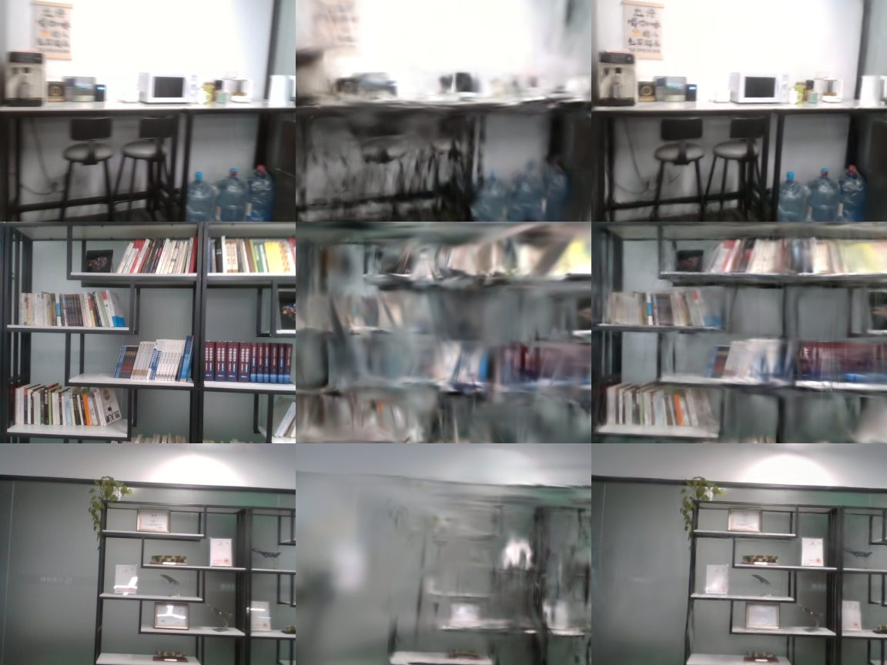
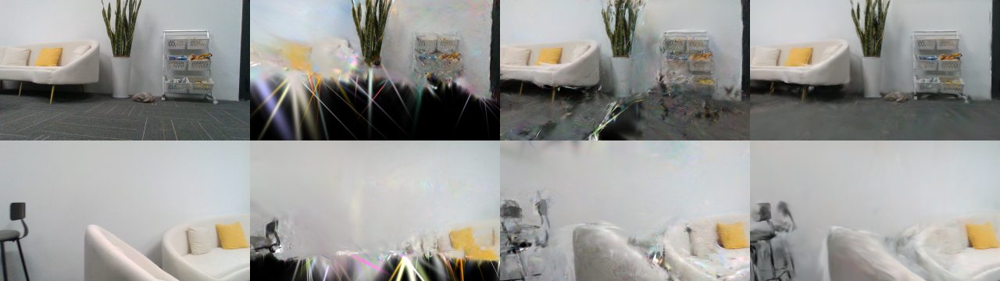

# 3DGS 离线重建：相机位姿、初始点云与评测

2026-10-16 · Claude（2026-10-19 补充两次新录制；2026-10-20 补充重影与针状高斯）

> 本文是 2026-10-16 至 10-21 的离线 3DGS 实验报告，各节数字是当时的测量。第 2 节的做法之后已实现为 `recon` 包，个别参数有变化。现行流程、命令和参数以 [recon/README.md](../../recon/README.md) 和[输入契约](../../recon/docs/INPUTS.md)为准。

本文记录飞行结束后用 3D 高斯泼溅（3DGS）还原场景的已验证做法。数据是同一办公室的三次室内录制：testflight3（D435i 彩色
640×480、15 fps、自动曝光，706 个关键帧）与 office_gs_01 / office_gs_02（1280×720、30 fps、手动曝光，570 / 673 个关键帧），
位姿来自 FAST-LIO，关键帧按运动选取（0.15 m / 8°）。训练器为 gsplat 1.5.3。流程当时是实验脚本，之后由 [`recon`](../../recon/README.md) 实现。本文自含结论与数值，`Data/` 下的原始材料只在文末证据索引中列出。

## 1. 结论

1. **3DGS 需要亚像素级一致的相机，点云不需要。** 相邻关键帧的对极误差（Sampson 距离中位）：LIO（RGB 时刻 +70 ms）
   2.28 px，VGGT-Omega 位姿（每窗一个 Sim(3) 放到地图）1.45 px，图像光束法平差（BA）后 0.33 px，纯图像 RANSAC 0.23 px。LIO 帧间相对旋转误差中位
   0.99°（P90 2.8°），在 640 宽的图像上约 10 px；同样的误差在点云里只有几厘米，肉眼看不出。
2. **用图像 BA 精化位姿（LIO 作初值和位置先验）后，3DGS 测试视角（未参与训练的视角）PSNR 从 16.2 dB 提到 20.5 dB**（全部 88 个测试帧）；
   在 39 个位姿可靠的测试帧上从 16.3 dB 提到 22.5 dB（两个集合各取最好的一组，见第 3 节）。
3. **深度模型对 3DGS 影响很小。** VGGT-Omega 与 DA3-GIANT 作为初始点云或深度损失，3DGS 差别不超过 0.4 dB。
4. **改采集比改算法收益大。** 换成 1280×720、30 fps、手动短曝光后，模糊关键帧从 12.9% 降到 0.4–0.7%；再放慢转向
   （关键帧角速度中位 21.9 → 13.8°/s），全部测试帧 PSNR（固定位姿 / 测试时位姿对齐）从 testflight3 的 20.3 / 21.5 dB
   提到 office_gs_02 的 23.5 / 24.2 dB，1280 训练、640 评分为 24.0 / 24.7 dB（第 9 节）。
5. **剩余误差集中在近处、少视角区域和难表示的内容。** 渲染深度 < 1 m 的像素占 19%，贡献 55% 的误差；误差最大的图块多是
   逆光百叶窗、走动的人、近距离快速转向时拍到的物体。噪声与卷帘快门不是主因（第 10 节）。
6. **离开航线的视角会快速变差，瓶颈是采集覆盖。** 现有测试帧都在航线上；离最近训练相机 0.25–0.5 m 时 18.6 dB，> 1 m 时 11.8 dB，
   同一位置换方向也低约 5 dB（第 11 节）。受控采集中，同样 38 帧，多方向覆盖比单方向一趟在新视角上高 6.5 dB，帧数增到 408 再高 3.7 dB（第 12 节）。
7. **重影来自 BA 支撑弱的帧，针状高斯可以在训练中约束掉。** 白墙多的场景里，SIFT + XFeat 合并的先验 BA 把训练中没有匹配的帧从 27 减到 5；
   再加各向异性正则（λ 0.1），针状高斯从约 3 万个降到约 130 个。三个随机种子平均，新视角 PSNR 提高 0.60 dB；
   换到独立场景 office_gs_02 上，留出段提高 0.18 dB，三个种子方向一致，针状高斯同样降到 0.1% 以下（第 13 节）。
   提升幅度远小于多方向采集带来的几 dB。

左：原图；中：LIO 位姿训练与渲染；右：LIO 位置先验 + SIFT BA 位姿，Omega 初始点云 + 深度损失。三行测试帧 PSNR
（中 → 右）分别为 16.7 → 29.0、14.3 → 19.2、16.4 → 27.2 dB。

## 2. 推荐流程

| 步骤 | 做法与参数 |
|---|---|
| 采集 | 1280×720、30 fps、手动曝光（亮处 8–10 ms）；转向不超过约 20°/s；离物体保持约 1 m 以上。同一区域来回多趟、换高度和朝向（第 12 节），不要只沿航线飞一遍。录制命令见 [NX 台架 · 录制离线重建数据](../src/drone3d_reconstruction_core/docs/NX_BRINGUP.md#录制离线重建数据3dgs-用) |
| 关键帧 | 运动关键帧 0.15 m / 8°，最长 2 s；不用起飞前的静止段。不要再按转速限制选帧（第 11 节） |
| 模糊帧 | 灰度拉普拉斯方差低于原始 5 Hz 序列中该帧前后各 10 帧（共 21 帧）中位数的 0.5 倍，判为模糊。模糊帧参与 BA，不参与 3DGS 训练。testflight3 有 91/706 帧 |
| 配对 | 时间相邻 15 帧（序列匹配）+ LIO 空间配对：相机中心距离 < 1.5 m、光轴夹角 < 45°，每帧最多 30 个最近邻 |
| 特征 | SIFT（pycolmap 默认参数），1280×720 原图提取。暗处图像先做 CLAHE（灰度，clipLimit 2.0，8×8 分块）再提特征（第 11 节，只验证了特征数与匹配内点数）；另对同样的配对做 XFeat 匹配（top_k 4096），每对用基础矩阵 RANSAC（阈值 1.0 px，置信度 0.999）只留内点，内点少于 30 的对丢弃。两种匹配写入同一个 COLMAP 数据库 |
| BA 初值与先验 | 先去掉 FAST-LIO 重复发布的位姿（`/Odometry` 约 100 Hz，位姿只在每帧激光后更新，10 Hz），再插值；初值为 RGB 时刻 +40 ms（去重后标定；testflight3 未去重时为 +70 ms）的 LIO 相机位姿。每帧相机中心加位置先验，各向同性 σ = 0.05 m（pycolmap 4.2 的 `PosePrior`，CARTESIAN，配合 `create_pose_prior_bundle_adjuster`）。结果直接在 LIO 米制坐标，不再做 Sim(3) 对齐 |
| BA 轮次 | 三角化 → BA → 过滤，重投影阈值 16 → 8 → 4 px 三轮；内参固定为标定值；末轮按 4 px / 最小三角化角 1.5° 过滤 |
| 初始点云 | VGGT-Omega 以 512 长边推理（1280×720 → 512×288）；逐帧深度 × 窗口尺度（与 frame_pose 同一估计，用 BA 位姿重估），在 BA 位姿下反投影。只留置信度高于本帧中位、3×3 相对深度跨度 ≤ 3%、深度 0.3–4 m、且至少一个邻帧印证的像素；先做 2 cm 体素，再放大体素到不超过 30 万点 |
| 训练 | gsplat DefaultStrategy，30000 步（60000 步更差，第 13 节），球谐 3 阶（每 1000 步升一阶），L1 / SSIM 权重 0.8 / 0.2，640×360 或 1280×720（后者在 640 评分下高约 0.5 dB），黑背景。不开训练时位姿优化，不开逐帧外观补偿 |
| 各向异性正则 | 损失加 0.1 × mean(relu(最长轴 / 最短轴 − 10))，对全部高斯，轴长取 exp 后的尺度。抑制针状高斯（第 13 节） |
| 深度损失（可选） | 1 − Pearson(1/渲染深度, 1/先验深度)，逐帧在先验有效像素上计算，权重 0.1。该损失与尺度、偏移无关，窗口尺度误差不会进入训练 |

耗时（RTX 5060 笔记本，706 帧）：SIFT 提取 + 序列匹配 46 s；XFeat 匹配 + RANSAC 约 11 min（11698 对，其中 7178 对复用了
已有匹配，完整运行会更长）；先验 BA 三轮 4.6 min（CPU 4 线程）；3DGS 训练 11–13 min，GPU 显存 reserved 峰值 1.5–2.6 GiB。

先验 BA 的结果：BA 中没有匹配到特征点的帧从 62（只用 SIFT）降到 19；相邻帧 Sampson 0.36 px；相机中心偏离 LIO 中位 13.6 cm、P90 24 cm。
只用 SIFT 的先验 BA 对极误差最低（0.326 px，中心偏离 7.1 cm），但无匹配帧仍是 62 个。

## 3. 各步收益

单随机种子，组间差小于 0.5 dB 不显著。“位姿可靠 39 帧”指清晰、且在两套 SIFT BA 中都有至少 100 个观测的测试帧。

| 相机 | 初始点云 | 训练帧 | 测试 PSNR，全部 88 帧（dB） | 位姿可靠 39 帧（dB） | 训练视角（dB） |
|---|---|---:|---:|---:|---:|
| LIO +70 ms | Omega 稠密 | 618 | 16.2 | 16.3 | 21.1 |
| VGGT-Omega 窗口位姿与预测内参 | Omega 稠密 | 618 | 16.1 | — | — |
| 默认 BA（LIO 初值，SIFT 序列匹配，4 px） | COLMAP 稀疏点 | 618 | 17.0 | — | 22.6 |
| 默认 BA | Omega 稠密 | 618 | 19.1 | 21.6 | 23.9 |
| 改进 BA（加空间配对，阈值 16 → 8 → 4 px） | Omega 稠密 | 618 | 20.2 | 22.2 | 24.8 |
| 改进 BA，训练剔除模糊帧和 BA 无匹配帧 | Omega 稠密 | 512 | 20.3 | 22.6 | 25.4 |
| 先验 BA（SIFT + XFeat） | DA3-GIANT 稠密 + 深度损失 | 537 | 20.5 | 22.2 | 25.1 |
| 同上，测试时位姿对齐 | 同上 | 537 | 21.8 | 22.9 | — |

位姿可靠 39 帧上最好的一组是“SIFT 先验 BA + Omega 初始点云 + 深度损失”：固定位姿 22.5 dB，测试时位姿对齐后 23.1 dB。

## 4. 失败的测试帧

全部 88 帧中有 13 帧低于 15 dB，渲染成整片灰雾或涂抹。它们周围的训练视角并不少：0.5 m、20° 内
的训练相机中位 3 台，其余 75 帧为 4 台。差别在测试帧自身的位姿：BA 观测数中位 34（其余帧 150），5 帧在 BA 中没有匹配、
仍是 LIO 初值，1 帧被 BA 放偏约 8°。

测试时位姿对齐：冻结全部高斯，只优化该测试帧的 6 自由度位姿，200 步 Adam，学习率 1e-4，损失 L1 + 0.2·(1 − SSIM)，
不拟合外观。对齐后失败帧从 13 降到 7；在位姿可靠帧上位姿只移动中位 0.27° / 1.4 cm，PSNR +0.6 dB。评测时固定位姿与
对齐后两种口径都要报，前者含测试帧位姿误差，后者反映模型本身。

## 5. 无效或有害的做法

- 调 LIO 时间偏移：testflight3 上 0–170 ms 扫描，最好的 100 ms 帧间旋转误差仍为 0.88°；手眼外参旋转修正无改善。
  1280×720 的两次录制上，去掉 FAST-LIO 的重复位姿后相邻帧 Sampson 从 3.86 / 3.73 降到 2.39 / 2.78 px，office_gs_02 的帧间旋转误差
  从 0.81° 降到 0.50°（详见 [G4 接入](../src/drone3d_reconstruction_core/docs/G4_INTEGRATION.md#逐帧位姿放置frame_pose)）；仍需图像 BA。
- 3DGS 训练时位姿优化（gsplat `CameraOptModule`）：在 LIO 位姿上 +0.5 dB；在 BA 位姿上降 0.8 dB（学习率 1e-5）或
  3.1 dB（1e-4）。
- 逐帧曝光补偿（RGB 对数增益 + 偏置）：测试帧只能用恒等变换，测试 PSNR 降 0.5–0.9 dB。
- 深度损失权重 0.3：降到 17.9 dB，失败帧 24 个。
- VGGT-X 全局对齐（XFeat 匹配，只优化位姿，不解三维点）：按其原配对规则（朝向差 < 30°，不看距离），80% 的配对相距
  超过 3 m、没有共视，一半匹配误差超过 20 px，结果 18.7 dB；改用空间配对和 RANSAC 内点后仍是 18.4 dB，不如 BA。
- 只用 XFeat、没有位置先验的 BA：无匹配帧从 62 降到 17，但轨迹整体弯曲，相对 LIO 的旋转差沿航线从 1.9° 增到 4.3°，
  3DGS 19.7 dB。加位置先验后相机中心偏离 LIO 从 26 cm 降到 12 cm。
- 纯图像 SfM（不用 LIO）：办公室工位重复，全量匹配会把不同区域误配到一起；只做序列匹配则断成 9–11 段，最大段只有
  约四分之一的帧。无人机数据纯图像 SfM 只注册了 101/706 帧。外部定位位姿是保持全局一致的必要输入。

## 6. 深度模型的作用

同一套 SIFT 先验 BA 位姿下：

| 深度来源 | 跨视深度不一致，中位 / P90（cm） | 3DGS 测试 PSNR，仅作初始点云（dB） | 加深度损失（dB） |
|---|---:|---:|---:|
| VGGT-Omega | 3.40 / 10.8 | 19.9 | 20.3 |
| DA3-GIANT-1.1 | 1.89 / 7.5 | 20.1 | 20.1 |

跨视深度不一致：618 个训练帧按时间取 i→i+1 与 i→i+3 共 1232 对，用位姿把源帧深度投到目标帧，与目标帧深度比较，
各组合使用同一批像素，不依赖 D435i。用 LIO 位姿时两者为 4.09 / 3.21 cm，位姿越准，DA3-GIANT 的优势越明显。
3DGS 训练会大幅改写初始点云，所以几何上的优势只留下不到 0.4 dB。离线 3DGS 两种模型都可以用；深度模型在实时点云
链路中的比较见 [G4 接入 · 深度来源](../src/drone3d_reconstruction_core/docs/G4_INTEGRATION.md#深度来源)。

## 7. 对照：手机视频

用两部手机在同一办公室各录约 115 s 视频（1080p HDR，转为 SDR 后降到 960×540），只用图像做 COLMAP（序列匹配，
共享相机，内参与畸变由 BA 求），在注册正确的最大片段上训练同一 3DGS。

| 输入 | 注册帧 / 输入帧 | 测试帧数 | 测试 PSNR（dB） | 训练视角 PSNR（dB） |
|---|---:|---:|---:|---:|
| Android | 79 / 346 | 10 | 29.8 | 38.2 |
| iPhone | 88 / 345 | 11 | 27.2 | 33.5 |
| 无人机 D435i，纯图像 SfM | 101 / 706 | 12 | 23.3 | 31.3 |

三者场景片段不同，测试帧只有 10–12 帧，训练视角只抽了 3–4 帧，只能粗比。它说明训练器与场景没有问题：相机一致的局部片段上，3DGS 可以接近照片级。两部手机之间的差别不显著。

## 8. 评测口径

- 测试帧：按时间每第 8 个关键帧，不进入 3DGS 训练损失；它们参与 BA 和初始点云融合（新视角合成基准的常规做法）。
- 指标：PSNR、SSIM、LPIPS（AlexNet），逐帧计算后取均值。同时报全部测试帧与位姿可靠子集、固定位姿与测试时位姿对齐。
- 不用 D435i 深度给 3DGS 或深度模型排名。D435i 单帧深度有斑块噪声和边缘扩散（前景膨胀），且全局快门深度与卷帘快门
  RGB 不同步；拿它当真值会偏向边缘同样扩散的预测。3DGS 看 RGB 指标，深度一致性用上面的跨视深度不一致。

## 9. 新采集：office_gs_01 与 office_gs_02

同一办公室、同一流程（SIFT 先验 BA，Omega 384 初始点云 + 深度损失，640×360 训练），单随机种子。

| | testflight3 | office_gs_01 | office_gs_02 |
|---|---|---|---|
| 相机设置 | 640×480，15 fps，自动曝光 | 1280×720，30 fps，8 ms，增益 128 | 1280×720，30 fps，10 ms，增益 96 |
| 关键帧角速度中位（°/s） | 8.7 | 21.9 | 13.8 |
| 模糊关键帧 | 12.9% | 0.7% | 0.4% |
| BA 中没有匹配到特征点的帧 | 62 / 706 | 3 / 570 | 21 / 673 |
| BA 后相邻帧 Sampson（640 宽等效） | 0.33 px | 0.22 px | 0.19 px |
| 全部测试帧 PSNR，固定 / 对齐（dB） | 20.3 / 21.5 | 22.1 / 22.9 | **23.5 / 24.2** |
| 1280 训练、640 评分（dB） | — | 22.7 / 23.5 | **24.0 / 24.7** |
| 测试帧 < 15 dB（对齐后） | 7 | 2 | 2 |

两次办公室录制航线不同，office_gs_02 还用了里程计去重，表中差值是整体差。testflight3 用 640×480 评分，两次办公室录制用 640×360。

转向速度：两次办公室录制的位姿可靠测试帧合并，按拍摄时角速度分档的 PSNR（固定位姿）为 < 5°/s 24.3 dB（11 帧）、5–10 23.5、
10–20 23.5、20–40 22.6、≥ 40 21.8 dB。20°/s 以下基本持平。

曝光：office_gs_02 的高频噪声比 office_gs_01 低三分之一（残差 1.87 vs 2.83，0–255），但关键帧亮度中位从 90 降到 75；
21 个无匹配帧中 20 个在一段 6 s 的暗会议区，亮度中位 12.6、SIFT 特征中位 171（全部关键帧 2718）。固定曝光在暗处不够用。

## 10. 误差在哪里

office_gs_01 的 71 个测试帧，测试时位姿对齐后逐像素统计（类别互有重叠，误差占比不能相加）：

| 像素类别 | 像素占比 | 误差（MSE）占比 |
|---|---:|---:|
| 渲染深度 < 1 m | 19% | 53% |
| 高纹理（梯度最高三分之一） | 33% | 59% |
| 深度边缘两侧 2 px | 27% | 35% |
| 训练视角可见 ≤ 5 次 | 15% | 38% |
| 过曝（任一通道 ≥ 250） | 1.2% | 11.5% |

- 误差最大的 20 个 64×64 图块里有 12 个是逆光百叶窗，其余是走动的人、近距离快速转向时的物体、屏幕反光。
- 噪声：静止帧对估计的噪声对应 PSNR 上限约 39.5 dB（640×360），不是瓶颈。
- 卷帘快门：误差没有随图像行从上到下单调变化，转得快的帧也没有，未见卷帘快门特征。
- VGGT 深度不是近处误差的来源（office_gs_02）：去掉深度损失后 < 1 m 像素的误差占比从 55% 升到 60%，只在 ≥ 1 m 计算深度损失时升到 64%，
  PSNR 分别降 0.2–0.3 dB 与 0.35–0.4 dB。Omega 改用 512 长边后，深度在 0.7–2 m 的相对误差中位从 2.9% 降到 2.2%（P90 9.5% → 7.1%，对 D435i，
  去掉深度边缘），3DGS +0.15 dB（对齐后中位 +0.58 dB）。Omega 与 DA3-GIANT 在 0.3–0.7 m 都明显变差（中位 3–6%，P90 16–27%）。

## 11. 离开训练轨迹的新视角

office_gs_02 中留出两段连续 15 s（93 帧，无人机在别的时刻从其他方向或相邻位置经过同一区域），只用其余帧训练（初始点云也只用训练帧的深度），
Omega 512 + 深度损失，测试时位姿对齐后评分。同一模型上，每第 8 帧的插值测试帧为 24.5 dB。

| 留出帧到最近训练相机的距离 | < 0.1 m | 0.1–0.25 m | 0.25–0.5 m | 0.5–1 m | > 1 m |
|---|---:|---:|---:|---:|---:|
| 帧数 | 13 | 24 | 12 | 19 | 25 |
| PSNR（dB） | 22.1 | 20.1 | 18.6 | 15.6 | 11.8 |

| 0.5 m 内训练相机与留出帧的最小光轴夹角 | < 10° | 20–45° | > 45° | 0.5 m 内没有训练相机 |
|---|---:|---:|---:|---:|
| 帧数 | 7 | 3 | 37 | 44 |
| PSNR（dB） | 23.3 | 19.0 | 19.7 | 13.4 |

- 位置相近且朝向相近时与插值持平；同一位置换方向（> 45°）比插值低约 5 dB；附近没有训练相机时降约 11 dB。
- 误差主要不在“从没拍到”的区域：按渲染深度投影统计，训练视角一次都看不到的像素占 11%，误差占 24%；其余 76% 的误差落在训练视角看到过、
  但只从单一方向或距离看到的区域（这些像素的平均绝对误差 21–42，插值帧为 8–16，0–255）。
- 原因是采集覆盖：办公室航线基本是每条过道单向飞一遍（只在路口交叉），每个表面只从很窄的方向范围被看到，3DGS 的几何只在这些方向上被约束。
  改善新视角要从航线设计入手（同一区域多方向、多高度或往返、绕飞），算法只能在已有覆盖内起作用。

## 12. 受控采集：单方向与多方向覆盖

在一面约 6 m 的墙前录一次连续航线（ctrl_wall_01，1280×720，10 ms / 增益 128）：来回 5 趟（偏航与高度各不相同）加一段原地转向，
之后升高（G 段，比所有训练段都高）和降低靠近（H 段）。G、H 共 174 帧作测试，三组都没训练过；同样的 SIFT 先验 BA 位姿、Omega 512 + 深度损失、
640×360、30000 步，初始点云只用各组训练帧的深度。

| 训练组 | 训练帧 | G + H 测试 PSNR，固定 / 对齐（dB） | 插值对照（第一趟每第 8 帧，dB） |
|---|---:|---:|---:|
| 单方向：只用第一趟 | 38 | 11.4 / 11.8 | 29.6 / 30.2 |
| 多方向：各趟与转向段合计，降采样到同样 38 帧 | 38 | 17.8 / 18.4 | 24.2 / 24.8 |
| 多方向，全部帧 | 408 | 21.3 / 22.1 | 29.2 / 29.9 |

- 帧数相同时，多方向覆盖让训练没出现过的视角提高 6.5 dB；再把帧数从 38 增到 408，又提高 3.7 dB。
- 单方向一趟在自己的轨迹上能到 30 dB，但离开轨迹只有 12 dB：测试像素里 58% 一次都没被训练视角看到（地面、侧面），它们贡献 93% 的误差，
  渲染成黑洞和放射状条纹。多方向全部帧时，86% 的测试像素被训练视角看到 10 次以上，误差的 62% 落在这些已覆盖像素上。
- 限制：第一趟有 9 个训练帧在 BA 中没有匹配（位姿未被图像精化），也偏亮（亮度中位 178），对单方向组略不利；只跑了一个随机种子。
  这些不改变量级判断：单方向组的误差主要来自从未被看到的区域。

## 13. 重影与针状高斯

上节"多方向，全部帧"的模型在新视角上有两类明显瑕疵：物体边缘的重影，以及从物体表面放射出去的细长条纹（针状高斯：
最长轴 ≥ 5 cm、长短轴比 ≥ 10、不透明度 > 0.1，共 30528 个，占 2.7%）。

- **重影与 BA 支撑相关。** 按训练帧在 SIFT 先验 BA 中的观测数分组，训练视角 PSNR：≥ 100 个观测 29.0 dB（227 帧），1–99 个 26.7 dB（154 帧），
  0 个 27.0 dB（27 帧）。白墙多、SIFT 特征少，这些帧的位姿和其余帧对不齐，同一物体被训练成错开的两份。
- **针状高斯是表面拟合的一部分，不能事后删。** 训练完直接删掉它们，新视角降到 21.84 dB、插值降到 28.6 dB。

每组只改一处，其余同第 12 节（408 训练帧，640×360，30000 步，单随机种子）。G + H 为 174 个测试帧；插值对照只有 5 帧，只作参考。

| 训练组 | 改动 | G + H 固定 / 对齐（dB） | 针状高斯 |
|---|---|---:|---:|
| 基线 | 第 12 节"多方向，全部帧" | 21.33 / 22.07 | 30528 |
| SIFT + XFeat 先验 BA | 两种匹配写入同一数据库，其余同第 2 节 | 21.93 / 22.62 | 29869 |
| 去掉 BA 观测 < 30 的训练帧 | 训练帧 408 → 335 | 21.63 / 22.44 | 31257 |
| 各向异性正则 λ 0.01 | 见第 2 节 | 21.41 / 22.21 | 1624 |
| 各向异性正则 λ 0.1 | 见第 2 节 | 21.84 / 22.57 | 159 |
| 抗锯齿光栅化 | gsplat `rasterize_mode='antialiased'` | 21.62 / 22.30 | 31413 |
| 60000 步 | 位置学习率按总步数衰减，其余调度不变 | 21.08 / 21.73 | 55198 |
| **SIFT + XFeat 先验 BA + 正则 λ 0.1** | 两者组合 | **22.28 / 22.91** | **133** |

- SIFT + XFeat 让 BA 中没有匹配的训练帧从 27 减到 5，观测数中位从 118 升到 908；1–99 个观测那组训练视角升到 27.7 dB。
  这和第 14 节 office_gs_01 上合并后 −0.25 dB 不矛盾：那次 SIFT 已几乎覆盖全部帧，这里白墙多，XFeat 补上了 SIFT 匹配不到的帧。
- 各向异性正则在训练中把针状高斯压到原来的 0.5%，新视角不降反升；λ 0.1 比 0.01 好。
- 60000 步训练视角高 0.8–1.4 dB，新视角却低 0.33 dB，针状高斯多了 81%，是过拟合。
- 组合是在同一组测试帧上挑出来的（两侧各取测试 PSNR 最高的一项），0.84 dB 是单种子结果。边缘重影减轻但没有消失。

**跨种子与跨场景复核。** 组合在 ctrl_wall_01 上再训练两个随机种子，并在独立场景 office_gs_02 上用第 11 节的连续留出切分重做（507 训练帧，留出 93 帧，插值 71 帧）。
每组三个种子（42、43、44），其余设置不变。对齐 PSNR，均值 ± 标准差，配对差为同种子相减：

| 场景 | 测试集 | 基线（dB） | 组合（dB） | 配对差（范围，dB） | 针状高斯占比 |
|---|---|---:|---:|---:|---|
| ctrl_wall_01 | G + H 174 帧 | 22.29 ± 0.21 | 22.89 ± 0.13 | +0.60（+0.26 ~ +0.84） | 2.7% → 0.01% |
| office_gs_02 | 留出 93 帧 | 17.01 ± 0.03 | 17.20 ± 0.04 | +0.18（+0.15 ~ +0.26） | 10.5% → 0.07% |
| office_gs_02 | 插值 71 帧 | 24.63 ± 0.10 | 24.88 ± 0.12 | +0.25（+0.23 ~ +0.28） | 同上 |

- 三个种子的提升方向一致，且大于基线种子间的标准差。原先单种子的 0.84 dB 是三个种子里最大的一次。
- 办公室留出段低于 15 dB 的帧从每种子 36–37 个降到 28–33 个；LPIPS 略差 0.011，渲染图肉眼看不出差别。
- 办公室上两项单独用（各一个种子）：SIFT + XFeat 先验 BA 留出段 +0.04 dB，正则 −0.03 dB，只有组合才有提升。office_gs_02 的 BA 无匹配帧数 21 → 6。
- 办公室留出段仍比插值低 7.5 dB。新视角的瓶颈是采集覆盖（第 11、12 节），这类训练改进只能补零点几 dB。

## 14. 无效或有害的做法（新采集）

- 训练时去掉转得快的帧：去掉角速度最高的 25% / 10%，全部测试帧 −0.47 / −0.22 dB，转得快的测试帧失去相邻视角，降 0.7–1.3 dB。
- 选关键帧时等转向变慢：office_gs_01 上以 40°/s 为限均值 +0.5 dB、但失败帧 2 → 7；office_gs_02 上以 20°/s 为限 −1.0 / −0.7 dB，失败帧 4 → 11。
  转得慢要靠飞行本身，不靠选帧。
- SIFT + XFeat 合并匹配：office_gs_01 上 SIFT 已几乎覆盖全部帧（无匹配帧 3），合并后 −0.25 dB。白墙多的场景里则有用（第 13 节）。
- CLAHE：对 office_gs_02 的 21 个无匹配帧，特征数中位 171 → 5266，有几何内点的帧 2 → 12；尚未重跑 BA，不知道对位姿和 3DGS 的影响。
- 跨航次新视角评测：用 office_gs_02 的模型渲染 office_gs_01 的视角只有 13–14 dB，离训练相机 0.25 m、10° 以内的帧也一样低。
  两次录制分别在傍晚（开灯、窗外暗）和上午（窗外亮），逐帧颜色拟合只回收 2.4 dB，物品也有变化；这个口径测的是光照与场景变化，不是新视角能力。

## 15. 已验证与未验证

已验证：上述数值来自同一办公室的三次室内录制，单随机种子。

未验证：

- 室外与百米级高度（高楼间穿行扫描）：没有跑过 3DGS；GNSS 位姿作先验时 σ 取多少未定；玻璃幕墙与重复窗格对匹配的影响未测。
- 多方向覆盖只在一面墙前的小区域验证（第 12 节）；大范围场景（整层办公室、楼宇立面）每个表面需要多少趟、什么航线，尚未测。
- 暗处的曝光策略（提高增益、补光或分区自动曝光）与 CLAHE 对 BA、3DGS 的实际收益。
- 训练视角 PSNR 仍只有约 26 dB，与手机局部片段的 33–40 dB 差距的成因。
- 随机种子方差只在两个场景各测了三个种子（第 13 节）；其余各节仍是单种子结果。
- 流程当时尚未写成仓库工具，之后已实现为 `recon`。

## 证据索引（本机，不入 Git）

实验根 `Data/experiments/接手诊断_20261008/tasks/`：

- 相机对照（LIO / VGGT / 位姿优化 / 外观补偿）：`T02_gs_cameras.md`、`T02_result.md`、`T02/`。
- 默认 BA、纯图像 SfM：`T03_ba_poses.md`、`T03_result.md`、`T03/`（含 `epi_check.py`，相邻帧 Sampson 口径）。
- 改进 BA、模糊帧：`T04_blur_ba.md`、`T04_result.md`、`T04/`（`blur.json` 为模糊帧名单）。
- VGGT-X 全局对齐：`T08_ga_depth.md`、`T08_result.md`；修正配对与 XFeat BA：`T09_xfeat_ba.md`、`T09_result.md`。
- LIO 位置先验 BA：`T11_prior_ba.md`、`T11_result.md`；深度损失与曝光补偿：`T12_depth_supervision.md`、`T12_result.md`；
  测试时位姿对齐、合并 SIFT + XFeat：`T13_pose_coverage.md`、`T13_result.md`。
- 失败帧覆盖与观测分析在本次会话内计算，输入为 `T02/cameras.npz`、`T11/cameras_P-SIFT.npz`、`T12/D-Omega/per_frame.json`。
- 本文配图：`doc_figure_gs_lio_vs_ba.py`（由 `T02/L/final.pt` 与 `T12/D-Omega/final.pt` 渲染帧 2110、2841、3351）。
- 时间偏移与外参扫描：会话内脚本，结论见本文第 5 节。

新采集（实验根 `Data/experiments/`）：`office_gs_01_20261016/T14_result.md`（首次 1280 录制）、`T15_result.md`（转速取舍与误差定位）；
`office_gs_02_20261019/T16_result.md`（第二次录制与转速分档）、`T17_result.md`（A 转速门控、B 近处深度、C 无匹配帧、D 跨航次）、
`T18_result.md`（连续时段留出的新视角，轨迹图与三联图在 `T18/`）；受控采集 `ctrl_capture_20261019/plan.md`、`T19_result.md`、`T19/montage.png`（本文第 12 节配图取自其中两行）；
重影与针状高斯 `ctrl_capture_20261019/T20_ghost_needles.md`、`T20_result.md`、`T20/montage.png`，针状统计脚本 `T19/needles/needles.py`、训练视角分组 `T19/needles/train_fit.py`；
跨种子与跨场景复核 `quality_check_20261021/T21_cross_scene_seeds.md`、`T21_result.md`、`T21_montage_office.png`（逐种子模型与评测在 `T21/`）。

手机对照：`Data/experiments/phone_room_20261015/T05_result.md`（全量匹配，误配）、`T07_result.md`（序列匹配，表中数值）；原视频 `Data/Room/`。
